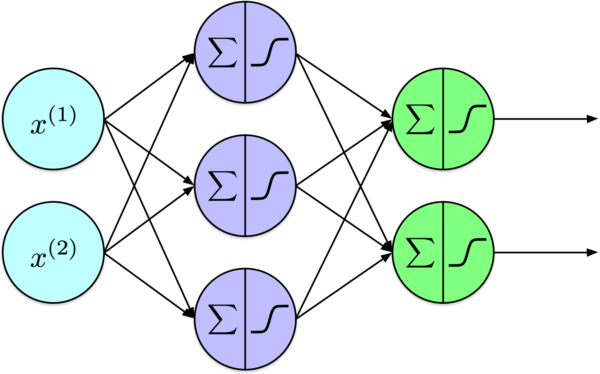
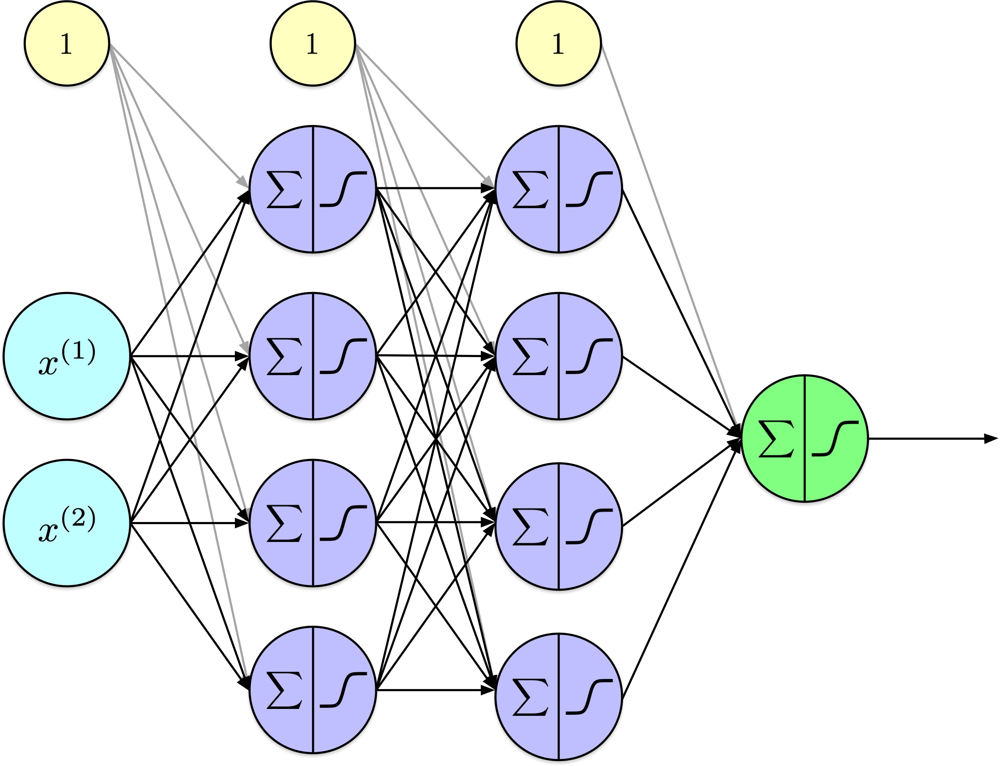
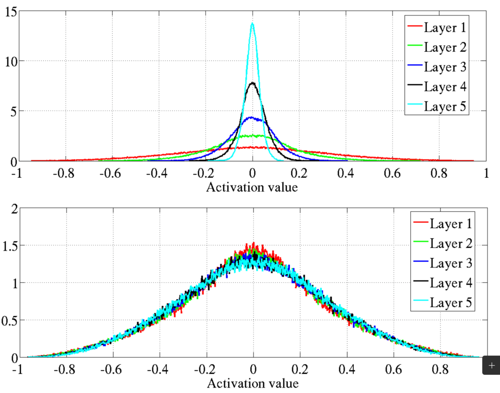
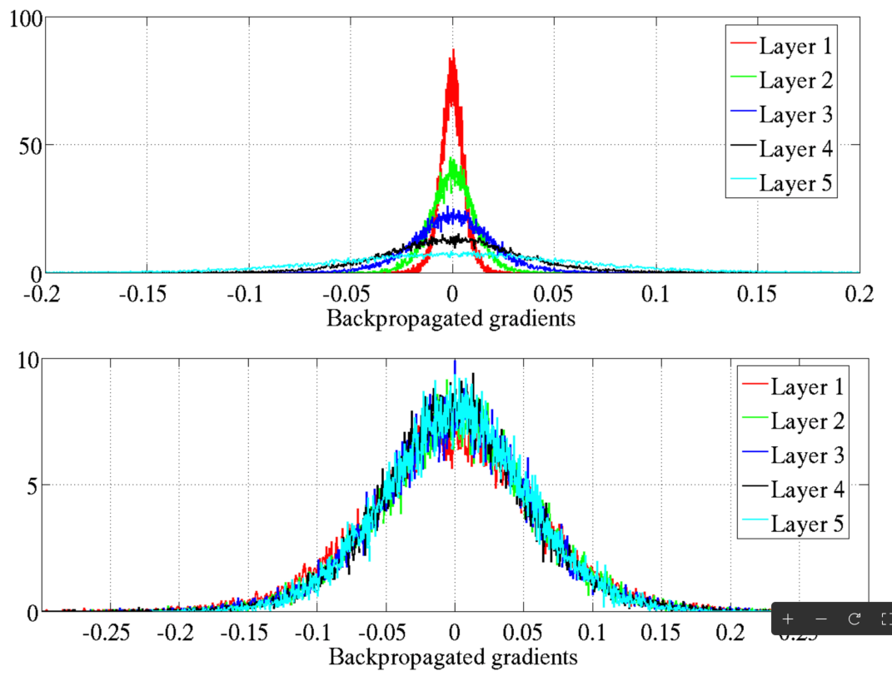
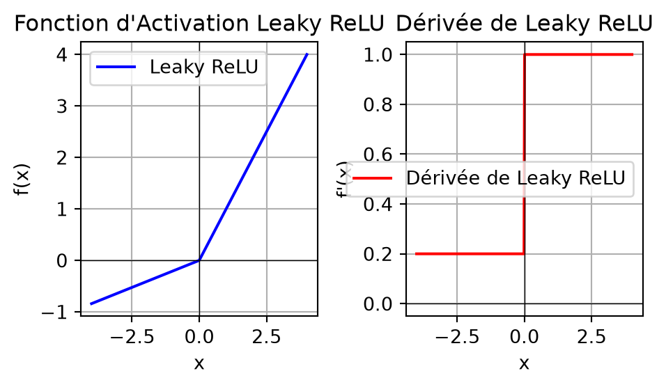
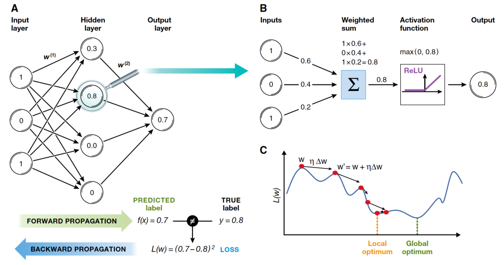

# Entraîner un réseau de neurones artificiels (partie 2)

CSI 4506 - automne 2026

Auteur·rice

Marcel Turcotte

Date de publication

Version: oct. 15, 2026 17h25

# Préambule

## Message du Jour

[](https://media.nature.com/lw767/magazine-assets/d41586-025-03135-z/d41586-025-03135-z_51543916.jpg?as=webp)

[‘Am I redundant?’: how AI changed my career in bioinformatics](https://www.nature.com/articles/d41586-025-03135-z), Nature News, 2025-10-13.

Bien que relativement peu d’étudiants envisagent une carrière dans la recherche, particulièrement en bioinformatique, l’article communique efficacement plusieurs messages clés. Il est intéressant de noter que même les titulaires d’un doctorat peuvent se sentir menacés par l’avènement de l’intelligence artificielle. L’article illustre en outre comment l’IA ne supprime pas les emplois, mais les transforme. Dans de nombreux domaines, cette transformation redéfinit les rôles vers ceux de supervision.

## Résultats d’apprentissage

- **Algorithme de Rétropropagation** :
  - **Discuter** des passes avant et arrière, en soulignant le calcul des gradients à l’aide de dérivées partielles pour mettre à jour les poids.
- **Problème de Gradient Évanescent** :
  - **Exposer** le problème et présenter des stratégies d’atténuation, telles que l’utilisation de fonctions d’activation comme ReLU ou l’initialisation des poids avec une attention particulière.

Lors du dernier cours, nous avons mis en œuvre un réseau neuronal à propagation avant pour illustrer son fonctionnement. Pour isoler notre compréhension conceptuelle des réseaux neuronaux de leurs méthodes d’entraînement, nous avons utilisé un algorithme d’entraînement de base par force brute. Aujourd’hui, nous nous concentrerons sur l’algorithme de rétropropagation, un élément essentiel dans les techniques d’apprentissage profond.

# Notation

## Unités, couches et fonctions d’activation

| Symbole | Signification |
|:---|:---|
| \\z^{(\ell)}\\ | Préactivations : sommes pondérées et biais de la couche \\\ell\\ |
| \\a^{(\ell)}\\ | Activations : sorties de la couche, notées \\o\\ pour les unités dans la présentation 11 |
| \\\varphi\\ | Fonction d’activation générale, appliquée élément par élément |
| \\\sigma\\ | Fonction d’activation sigmoïde logistique |
| \\W^{(\ell)}, b^{(\ell)}\\ | Poids et biais de la couche |
| \\f\_\ell\\ | Transformation complète d’une couche : calcul affine suivi de l’activation |

Le symbole \\\varphi\\ désigne toujours une fonction d’activation; \\f\_\ell\\ désigne une couche entière, y compris ses poids et ses biais. La sigmoïde est notée \\\sigma\\. Ces rôles distincts évitent d’utiliser le même symbole pour une activation scalaire et pour la transformation complète d’une couche.

L’implémentation utilise `a` pour les activations. Ces quantités correspondent aux sorties des unités notées \\o\\ dans la présentation 11. Les minuscules \\a\\ et \\z\\ décrivent un exemple, tandis que les majuscules \\A\\ et \\Z\\ décrivent un lot d’exemples stockés en lignes. Les activations d’entrée sont \\A^{(0)}=X\\.

## Notation : réseau à deux couches

Une couche cachée et une couche de sortie :

\\ \hat{Y}=f_2(f_1(X)) \\

Chaque couche calcule

\\ f\_\ell(A)=\varphi(AW^{(\ell)}+b^{(\ell)}). \\

[](../../assets/images/ann_mlp-07-01.png)

Cette écriture suit la convention NumPy de la présentation 12 : `a @ W + b`. La matrice de poids a pour dimensions `(units_in, units_out)`, et le vecteur de biais est ajouté à chaque exemple par diffusion. Les nœuds d’entrée transmettent les attributs inchangés et ne sont pas comptés comme des couches paramétrées.

La notation \\\hat{Y}\\ regroupe les sorties du réseau pour un lot. Dans les exemples de classification binaire, l’unique colonne de sortie contient des probabilités prédites, et non des étiquettes obtenues par seuillage. Les couches peuvent utiliser des fonctions d’activation différentes; \\\varphi\\ représente l’activation choisie pour la couche étudiée.

## Notation : réseau à trois couches

Deux couches cachées et une couche de sortie :

\\ \hat{Y}=f_3(f_2(f_1(X))) \\

où

\\ f\_\ell(A)=\varphi(AW^{(\ell)}+b^{(\ell)}). \\

[](../../assets/images/ann_mlp-14-01.png)

## Notation : réseau à \\L\\ couches

\\ \hat{Y}=f_L(\ldots f_2(f_1(X))\ldots). \\

Pour \\\ell=1,\ldots,L\\ :

\\ Z^{(\ell)}=A^{(\ell-1)}W^{(\ell)}+b^{(\ell)}, \qquad A^{(\ell)}=\varphi(Z^{(\ell)}). \\

La sortie d’une couche devient l’entrée de la suivante.

Seule la première couche paramétrée reçoit les attributs d’entrée d’origine. Les couches suivantes traitent les activations de la couche précédente. Chaque couche répète le même schéma de calcul avec ses propres paramètres.

Ajouter des couches ajoute des calculs et des valeurs intermédiaires à conserver. La structure régulière permet d’étendre les mêmes procédures de propagation avant et arrière aux réseaux plus profonds; elle ne rend pas le coût indépendant de la profondeur.

# Rétropropagation

------------------------------------------------------------------------

[](https://imgs.xkcd.com/comics/machine_learning_2x.png)

**Attribution :** [xkcd.com/1838](https://xkcd.com/1838)

## Rétropropagation

**Apprentissage de représentations par rétropropagation des erreurs**

*David E. Rumelhart, *Geoffrey E. Hinton* & Ronald J. Williams*

Nous décrivons une nouvelle procédure d’apprentissage, la rétropropagation, pour les réseaux d’unités semblables à des neurones. La procédure **ajuste à plusieurs reprises les poids** des connexions dans le réseau afin de **minimiser une mesure de la différence entre le vecteur de sortie réel du réseau et le vecteur de sortie souhaité**. En conséquence des ajustements de poids, les unités internes ‘**cachées**’ qui ne font pas partie de l’entrée ou de la sortie en viennent à **représenter des attributs importants du domaine de la tâche**, et les régularités de la tâche sont capturées par les interactions de ces unités. La **capacité à créer de nouveaux attributs utiles** distingue la rétropropagation des méthodes antérieures, plus simples, telles que la procédure de convergence du perceptron.

Rumelhart et al. ([1986](#ref-Rumelhart:1986aa)); Texte traduit de l’anglais ci-dessus par ChatGPT.

Je présente ici le résumé de la publication fondatrice de Nature où Hinton et ses collègues ont introduit l’algorithme de rétropropagation. Ce résumé est à la fois élégant et informatif, capturant efficacement les principes fondamentaux des réseaux de neurones modernes : le concept de fonction de perte, l’ajustement itératif des poids via l’algorithme de descente de gradient, et le rôle crucial des couches cachées dans la génération d’attributs utiles dépendantes des tâches.

Nature est une revue prestigieuse, et elle publie rarement du contenu lié à l’informatique.

Au moment de cette publication, Hinton était affilié à l’Université Carnegie Mellon. Pour rappel, Hinton a reçu le prix Nobel de physique en 2024 pour ses contributions au développement des méthodes fondamentales de l’apprentissage automatique moderne.

Le résumé souligne la raison d’être des couches cachées dans les réseaux de neurones. Les couches cachées initiales apprennent des représentations simples directement à partir des données d’entrée, tandis que les couches suivantes identifient des associations parmi ces représentations. Chaque couche s’appuie sur la connaissance des couches précédentes, culminant dans la sortie finale du réseau.

## Avant la rétropropagation

- Des limitations, telles que **l’incapacité à résoudre la tâche de classification XOR**, ont essentiellement **stoppé** la recherche sur les réseaux neuronaux.

- Le perceptron était **limité à une seule couche**, et il n’existait **aucune méthode connue pour entraîner un perceptron multi-couches**.

- Les perceptrons à une seule couche sont limités à résoudre des tâches de classification qui sont **linéairement séparables**.

## Rétropropagation : contributions

- Le modèle utilise **l’erreur quadratique moyenne** comme **fonction de perte**.

- La **descente de gradient** est utilisée pour minimiser la **perte**.

- Une **fonction d’activation sigmoïde** est utilisée au lieu d’une fonction de seuil, car sa **dérivée** fournit des informations précieuses pour la descente de gradient.

- Montre comment mettre à jour les **poids internes** en utilisant un algorithme en **deux passes** consistant en une passe **avant** et une passe **arrière**.

- **Permet l’entraînement des perceptrons multi-couches.**

## Idée Conceptuelle

[](../../assets/images/ann_mlp-2-4-4-1.png)

\\J(\theta) = -\frac{1}{N} \sum\_{i=1}^{N} \left\[ y_i \log \hat{y_i} + (1-y_i) \log (1 - \hat{y_i}) \right\]\\

Étant donné un réseau et des paramètres qui ont été initialisés aléatoirement, nous pouvons générer des prédictions (\\\hat{y_i}\\) ; cependant, pour toute tâche non triviale, ces prédictions initiales sont susceptibles d’être inexactes en raison de la nature aléatoire de l’initialisation des paramètres.

Dans le contexte d’un problème de classification binaire, quel niveau d’exactitude (*accuracy*) pourrait-on anticiper ?

Correctement, on s’attendrait à une exactitude (*accuracy*) d’environ 50 %, en supposant que le jeu de données est équilibré.

Pour évaluer les performances du modèle, nous utilisons une fonction de perte, ici l’entropie croisée binaire (également connue sous le nom de vraisemblance logarithmique négative). Cette fonction calcule la moyenne des pertes sur les exemples d’entraînement, comme l’entropie croisée binaire moyenne de la présentation 12. Le terme intérieur de la somme calcule la perte d’un exemple.

Dans le calcul de la perte, \\\hat{y}\_i = h(x_i) = f_L(\ldots f_2(f_1(x_i))\ldots)\\, où \\f\_\ell(A)=\varphi(AW^{(\ell)}+b^{(\ell)})\\ et \\\varphi\\ sans indice est la fonction d’activation, sigmoïde, ReLU, etc.

## Idée Conceptuelle (suite)

[](../../assets/images/ann_mlp-2-4-4-1.png)

\\\frac {\partial}{\partial \theta_k}J(\theta)\\, pour tout \\k\\, où les \\\theta_k\\ sont `W[l][i,j]` et `b[l][j]`.

Dans cette notation, l’indice `l` désigne les couches de traitement au sein du modèle. L’indice `i` se réfère aux unités individuelles au sein de la couche précédente, notée `l-1`, tandis que l’indice `j` correspond aux unités au sein de la couche actuelle `l`.

Combien de paramètres sont présents dans le modèle ?

Le modèle se compose de trois matrices de poids. Les dimensions de ces matrices sont \\2 \times 4\\, \\4 \times 4\\, et \\4 \times 1\\, contenant respectivement 8, 16 et 4 poids. Cela donne un total de 28 paramètres de poids.

De plus, il y a trois tableaux pour les termes de biais, contenant respectivement 4, 4 et 1 biais, ce qui fait un total de 9 paramètres de biais.

En tout, le modèle comprend 37 paramètres, ce qui est relativement petit en comparaison avec des modèles plus complexes. Par exemple, le modèle Fashion-MNIST présenté dans la présentation 11 avait 266,610 paramètres. Dans l’apprentissage automatique contemporain, il n’est pas rare que les modèles contiennent des millions voire des milliards de paramètres.

## Idée Conceptuelle (suite)

[](../../assets/images/ann_mlp-2-4-4-1.png)

Pour un nombre fixe d’époques : \\\theta = \theta - \alpha \nabla\_\theta J(\theta)\\

Des critères d’arrêt alternatifs sont fréquemment utilisés dans les algorithmes d’apprentissage. Par exemple, le processus peut s’arrêter une fois que la perte d’apprentissage atteint un seuil suffisamment bas ou lorsque la perte de validation a augmenté sur un nombre prédéfini d’époques.

Les paramètres du modèle sont mis à jour simultanément, et ces mises à jour peuvent être calculées efficacement en parallèle.

Ce processus est connu sous le nom de descente de gradient. Comme discuté précédemment, lorsque les mises à jour des paramètres sont effectuées en utilisant l’ensemble du jeu de données, la méthode est appelée **descente de gradient par lot**. À l’inverse, lorsque les mises à jour sont faites en utilisant un seul exemple d’apprentissage, cela est appelé **descente de gradient stochastique**. Enfin, lorsqu’un petit sous-ensemble d’exemples, connu sous le nom de lot (mini-batch), est utilisé pour les mises à jour des paramètres, la méthode est appelée **descente de gradient par mini-lots**.

Notre tâche actuelle consiste à déterminer les dérivées partielles de la fonction de perte par rapport à chacun des 37 paramètres de notre modèle.

## Rétropropagation

- **Rétropropagation** (*backprop*) est un algorithme pour **calculer méthodiquement** les **dérivées partielles** de la fonction de perte d’un réseau de neurones par rapport à chaque paramètre de **poids** et de **biais**.

- **Rétropropagation** applique la **règle de la chaîne** (*chain rule*) du calcul différentiel **récursivement** pour calculer \\\frac{\partial J}{\partial w\_{i,j}^{(\ell)}}\\ pour tous les paramètres du réseau \\w\_{i,j}^{(\ell)}\\ de manière efficace, en utilisant des quantités intermédiaires du passage avant, où \\w\_{i,j}^{(\ell)}\\ désigne le paramètre \\w\_{i,j}\\ de la couche \\\ell\\.

## Fonctions d’activation et dérivées

Afficher le code

``` python
# Attribution: https://github.com/ageron/handson-ml3/blob/main/10_neural_nets_with_keras.ipynb

import numpy as np
import matplotlib.pyplot as plt

from scipy.special import expit as sigmoid

def relu(z):
    return np.maximum(0, z)

def derivative(f, z, eps=0.000001):
    return (f(z + eps) - f(z - eps))/(2 * eps)

max_z = 4.5
z = np.linspace(-max_z, max_z, 200)

plt.figure(figsize=(11, 3.1))

plt.subplot(121)
plt.plot(z, relu(z), "m-.", linewidth=2, label="ReLU")
plt.plot(z, sigmoid(z), "g--", linewidth=2, label="Sigmoïde")
plt.plot(z, np.tanh(z), "b-", linewidth=1, label="Tanh")
plt.grid(True)
plt.title("Fonctions d'activation")
plt.axis([-max_z, max_z, -1.65, 2.4])
plt.gca().set_yticks([-1, 0, 1, 2])
plt.legend(loc="lower right", fontsize=13)

plt.subplot(122)
plt.plot(z, derivative(sigmoid, z), "g--", linewidth=2, label="Sigmoïde")
plt.plot(z, derivative(np.tanh, z), "b-", linewidth=1, label="Tanh")
plt.plot([-max_z, 0], [0, 0], "m-.", linewidth=2)
plt.plot([0, max_z], [1, 1], "m-.", linewidth=2)
plt.plot([0, 0], [0, 1], "mo", markersize=6, markerfacecolor="white")
plt.grid(True)
plt.title("Dérivées")
plt.axis([-max_z, max_z, -0.2, 1.2])

plt.show()
```

[](slides_files/figure-html/cell-2-output-1.png)

Géron ([2022](#ref-Geron:2022aa)) – [10_neural_nets_with_keras.ipynb](https://github.com/ageron/handson-ml3/blob/main/10_neural_nets_with_keras.ipynb)

Les ensembles de valeurs de sortie sont les suivants :

- La sigmoïde produit des valeurs dans l’intervalle ouvert \\(0,1)\\.
- La tangente hyperbolique (\\\tanh\\) produit des valeurs dans l’intervalle ouvert \\(-1,1)\\.
- ReLU produit des valeurs dans l’intervalle \\\[0,\infty)\\.

Pour les dérivées :

- La dérivée maximale de la sigmoïde vaut 0,25.
- La dérivée maximale de \\\tanh\\ vaut 1.
- La dérivée de ReLU vaut 0 pour les entrées négatives et 1 pour les entrées positives. En zéro, la dérivée ordinaire n’est pas définie; les cercles ouverts indiquent cette rupture. Les implémentations choisissent une valeur en ce point, souvent zéro.

La sortie d’une unité ReLU n’est pas limitée à 0 ou 1. En dehors de zéro, sa dérivée locale vaut 0 ou 1. Le gradient d’un paramètre dépend aussi des activations entrantes et des dérivées propagées depuis les opérations suivantes.

## Règle de la chaîne

Étant donné,

\\ h(x) = f(g(x)) \\

en utilisant la notation de **Lagrange**, nous avons

\\ h^\prime(x) = f^\prime(g(x)) g^\prime(x) \\

ou de manière équivalente en utilisant la notation de **Leibniz**

\\ \frac{dz}{dx} = \frac{dz}{dy} \cdot \frac{dy}{dx} \\

La **règle de la chaîne** est un concept fondamental en calcul utilisé pour déterminer la dérivée d’une **fonction composée**. Plus précisément, si une fonction \\h\\ est définie comme la composition de deux fonctions différentiables, \\f\\ et \\g\\, la règle de la chaîne fournit une méthode pour calculer \\h^\prime\\.

Conceptuellement, la règle de la chaîne affirme que si vous connaissez le taux de variation instantané de \\z\\ par rapport à \\y\\, et le taux de variation de \\y\\ par rapport à \\x\\, vous pouvez trouver le taux de variation de \\z\\ par rapport à \\x\\. Cela est réalisé en multipliant ces deux taux de variation.

Vous voyez maintenant le lien avec la notation compacte des couches, \\\hat{Y} = f_L(\ldots f_2(f_1(X))\ldots)\\, où \\f\_\ell(A)=\varphi(AW^{(\ell)}+b^{(\ell)})\\, introduite au début de cette présentation.

## Application récursive

[](../../assets/images/ann_partial_Juz.png)

Où \\u\\ est un paramètre du modèle, un de ces \\w\_{i,j}^{(\ell)}\\ et \\b\_{j}^{(\ell)}\\.

La rétropropagation simplifie le processus de calcul en le décomposant en une série d’étapes élémentaires, où la règle de la chaîne est appliquée méticuleusement à chaque étape.

Considérons une fonction représentée par un cadre rose, paramétrée par \\u\\, qui produit une sortie \\z\\. Cette sortie \\z\\ sert d’entrée à une autre fonction, aboutissant finalement à une entrée pour la fonction de perte \\J\\.

L’expression \\\frac{\partial J}{\partial u}\\ désigne la dérivée partielle de \\J\\ par rapport à \\u\\. Cette dérivée quantifie la sensibilité de la perte \\J\\ aux variations du paramètre \\u\\, indiquant si \\u\\ doit être augmenté ou diminué, et de quelle ampleur, pour minimiser la perte.

Selon la règle de la chaîne, si \\\frac{\partial J}{\partial z}\\ est déjà connu, alors \\\frac{\partial J}{\partial u}\\ peut être calculé comme \\\frac{\partial z}{\partial u} \cdot \frac{\partial J}{\partial z}\\.

## Graphe computationnel

[](../../assets/images/ann_mlp-2-4-1.png)

[](../../assets/images/ann_comp_graph-row-vectors.svg)

Un **perceptron à deux couches** et son **graphe computationnel** associé.

Le réseau illustré à droite est plus général que celui à gauche. À droite, \\x\\ est un vecteur, et les boîtes roses représentent des opérations sur les vecteurs. Par conséquent, chaque couche peut accueillir un nombre arbitrairement grand d’unités.

\\W^{(l)}\\ fait référence aux matrices de poids, \\b^{(l)}\\ aux vecteurs de biais, \\z^{(l)}\\ aux vecteurs de pré-activation, et \\a^{(l)}\\ aux vecteurs d’activation, chacun associé à la couche \\l\\.

À des fins d’illustration, la représentation à droite montre la perte associée à un seul exemple. Pour calculer la perte sur l’ensemble du jeu de données d’entraînement, il faut agréger ces pertes individuelles et diviser ensuite la somme par le nombre total d’exemples, ce qui donne la perte moyenne.

## Entrée scalaire; un nœud caché

Soit

\\ J = -\Bigl\[y \\\log(\hat y) + (1-y)\\\log(1-\hat y)\Bigr\] \\

\\ \hat y = a_2 = \sigma(z_2), \quad z_2 = w_2 \cdot a_1 + b_2 \\

\\ a_1 = \sigma(z_1), \quad z_1 = w_1 \cdot x + b_1 \\

[](../../assets/images/ann_comp_graph-row-vectors.svg)

La partie gauche présente les équations pour un réseau neuronal de base avec une entrée scalaire, notée \\x\\, et un seul nœud caché. Chaque couche de ce réseau est caractérisée par un poids, et donc une notation simplifiée avec un seul indice est utilisée.

À l’inverse, la partie droite illustre le réseau en utilisant la notation vectorielle. Dans ce contexte, \\W^{(\ell)}\\ représente la matrice de poids pour la couche \\\ell\\. Les dimensions de cette matrice sont définies comme \\\text{entrée} \times \text{sortie}\\, où **entrée** se réfère au nombre d’activations de la couche précédente, et **sortie** indique le nombre de nœuds dans la couche actuelle.

Dans cette discussion, nous nous concentrerons sur les équations scalaires pour améliorer la clarté et la simplicité. Bien que notre attention soit portée sur les formes scalaires, les principes s’étendent au cas plus général en utilisant le calcul vectoriel.

## Dérivées

\\ \frac{\partial J}{\partial \hat{y}} \\

\\ \frac{\partial \hat{y}}{\partial z_2} \\

\\ \frac{\partial z_2}{\partial w_2}, \quad \frac{\partial z_2}{\partial b_2}, \quad \frac{\partial z_2}{\partial a_1}, \\

\\ \frac{\partial a_1}{\partial z_1}, \\

\\ \frac{\partial z_1}{\partial w_1}, \quad \frac{\partial z_1}{\partial b_1}, \quad \frac{\partial z_1}{\partial x}, \\

[](../../assets/images/ann_comp_graph-row-vectors.svg)

## Dérivées

Dérivée de la perte par rapport à \\\hat{y}\\ :

\\ \frac{\partial J}{\partial \hat{y}} = -\left(\frac{y}{\hat{y}}-\frac{1-y}{1-\hat{y}}\right) \\

[](../../assets/images/ann_comp_graph-row-vectors.svg)

## Dérivées

Dérivée de \\\hat{y}\\ par rapport à \\z_2\\:

\\ \frac{\partial \hat{y}}{\partial z_2}=\sigma^{\prime}\left(z_2\right)=\hat{y}(1-\hat{y}) \\

[](../../assets/images/ann_comp_graph-row-vectors.svg)

## Dérivées

Dérivée \\z_2 = w_2 a_1 + b_2\\:

\\ \frac{\partial z_2}{\partial w_2}=a_1, \quad \frac{\partial z_2}{\partial b_2}=1, \quad \frac{\partial z_2}{\partial a_1}=w_2 \\

[](../../assets/images/ann_comp_graph-row-vectors.svg)

## Dérivées

Dérivée \\a_1 = \sigma(z_1)\\ :

\\ \frac{\partial a_1}{\partial z_1}=\sigma^{\prime}\left(z_1\right)=a_1\left(1-a_1\right) \\

[](../../assets/images/ann_comp_graph-row-vectors.svg)

## Dérivées

Dérivée \\z_1 = w_1 x + b_1\\ :

\\ \frac{\partial z_1}{\partial w_1}=x, \quad \frac{\partial z_1}{\partial b_1}=1, \quad \frac{\partial z_1}{\partial x} = w_1 \\

[](../../assets/images/ann_comp_graph-row-vectors.svg)

## Dérivées combinées

Pour \\w_2\\ :

\\ \frac{\partial J}{\partial w_2}=\frac{\partial J}{\partial \hat{y}} \cdot \frac{\partial \hat{y}}{\partial z_2} \cdot \frac{\partial z_2}{\partial w_2}=\left\[-\left(\frac{y}{\hat{y}}-\frac{1-y}{1-\hat{y}}\right)\right\] \cdot(\hat{y}(1-\hat{y})) \cdot a_1 \\

Se simplifie en :

\\ \frac{\partial J}{\partial w_2}=(\hat{y}-y) a_1 \\

[](../../assets/images/ann_comp_graph-row-vectors.svg)

## Dérivées combinées

Pour \\b_2\\ :

\\ \frac{\partial J}{\partial b_2}=\frac{\partial J}{\partial \hat{y}} \cdot \frac{\partial \hat{y}}{\partial z_2} \cdot \frac{\partial z_2}{\partial b_2}=(\hat{y}-y) \cdot 1=\hat{y}-y \\

[](../../assets/images/ann_comp_graph-row-vectors.svg)

## Dérivées combinées

Pour \\w_1\\ :

\\ \frac{\partial J}{\partial w_1}=\frac{\partial J}{\partial \hat{y}} \cdot \frac{\partial \hat{y}}{\partial z_2} \cdot \frac{\partial z_2}{\partial a_1} \cdot \frac{\partial a_1}{\partial z_1} \cdot \frac{\partial z_1}{\partial w_1} \\

Substituer :

\\ =\left\[-\left(\frac{y}{\hat{y}}-\frac{1-y}{1-\hat{y}}\right)\right\] \cdot(\hat{y}(1-\hat{y})) \cdot w_2 \cdot\left(a_1\left(1-a_1\right)\right) \cdot x \\

Se simplifie à :

\\ \frac{\partial J}{\partial w_1}=(\hat{y}-y) w_2\left(a_1\left(1-a_1\right)\right) x \\

[](../../assets/images/ann_comp_graph-row-vectors.svg)

## Dérivées combinées

Pour \\b_1\\ :

\\ \frac{\partial J}{\partial b_1}=\frac{\partial J}{\partial \hat{y}} \cdot \frac{\partial \hat{y}}{\partial z_2} \cdot \frac{\partial z_2}{\partial a_1} \cdot \frac{\partial a_1}{\partial z_1} \cdot \frac{\partial z_1}{\partial b_1} \\

Substituer :

\\ =(\hat{y}-y) w_2\left(a_1\left(1-a_1\right)\right) \cdot 1 \\

Se simplifie à :

\\ \frac{\partial J}{\partial b_1}=(\hat{y}-y) w_2\left(a_1\left(1-a_1\right)\right) \\

[](../../assets/images/ann_comp_graph-row-vectors.svg)

## Dérivées clés

\\ \begin{align} \frac{\partial J}{\partial w_2} & = (\hat{y}-y) a_1 \\ \frac{\partial J}{\partial b_2} & = \hat{y}-y \\ \frac{\partial J}{\partial w_1} & = (\hat{y}-y) w_2\left(a_1\left(1-a_1\right)\right) x \\ \frac{\partial J}{\partial b_1} & = (\hat{y}-y) w_2\left(a_1\left(1-a_1\right)\right) \\ \end{align} \\

[](../../assets/images/ann_comp_graph-row-vectors.svg)

**Observation 1 :** Le calcul des gradients clés nécessite les valeurs d’activation de toutes les couches, spécifiquement \\a_1\\ et \\\hat{y} = a_2\\.

## Exploration

``` python
import math
import random

random.seed(42)

def sigma(x):
    return 1 / (1 + math.exp(-x))

alpha = 0.1

def init():

    global w1, w2, b1, b2

    w1 = random.random()
    w2 = random.random()
    b1 = 0
    b2 = 0
```

Nous considérons un modèle de réseau de neurones simple. Il accepte une seule entrée scalaire, notée \\x\\, et comprend un seul nœud caché caractérisé par un poids \\w_1\\ et un biais \\b_1\\. Il inclut également un nœud de sortie avec un poids \\w_2\\ et un biais \\b_2\\. Au total, le réseau contient quatre paramètres entraînables.

## Forward

``` python
def forward():

    global z1, w1, x, b1, a1, z2, J, y_hat

    z1 = w1 * x + b1
    a1 = sigma(z1)

    z2 = w2 * a1 + b2
    a2 = sigma(z2)

    y_hat = a2

    J = -(y * math.log(y_hat) + (1-y) * math.log(1 - y_hat))
```

Lors du passage en avant, les calculs progressent de manière séquentielle à travers chaque couche, en calculant les valeurs de préactivation et d’activation, notées `z1`, `a1`, `z2` et `a2`. La valeur `a2` représente la sortie du modèle, qui est ensuite utilisée pour déterminer la perte.

## Rétropropagation

``` python
def backward():

    global alpha, w1, b1, w2, b2, a1, z1, z2, y, y_hat

    grad_J_w2 = (y_hat - y) * a1
    grad_J_b2 = y_hat - y

    grad_J_w1 = (y_hat - y) * w2 * (a1 * (1-a1)) * x
    grad_J_b1 = (y_hat - y) * w2 * (a1 * (1-a1))

    w2 = w2 - alpha * grad_J_w2
    b2 = b2 - alpha * grad_J_b2

    w1 = w1 - alpha * grad_J_w1
    b1 = b1 - alpha * grad_J_b1
```

Lors de la rétropropagation, les dérivées partielles, ou gradients, sont calculées pour chacun des quatre paramètres. Ensuite, ces gradients sont utilisés pour mettre à jour les poids correspondants par un processus appelé mise à jour par gradient.

## Entraînement

``` python
init()

x = 3.14
y = 1

forward()
print(f"Avant : y_hat = {y_hat:.2}, loss = {J:.2}")

for i in range(500):
    forward()
    backward()

forward()
print(f"Après : y_hat = {y_hat:.2}, loss = {J:.2}")
```

    Avant : y_hat = 0.51, loss = 0.68
    Après : y_hat = 0.99, loss = 0.01

Le processus d’entraînement que nous avons mis en œuvre est basé sur une seule instance de données. En l’état actuel, notre architecture de réseau de base est limitée au traitement de cet unique exemple, principalement en raison de la nature codée en dur de la fonction de perte, qui est spécifiquement conçue pour un seul input. Cependant, vous pouvez expérimenter avec divers paramètres pour observer leurs effets sur la performance du modèle. Ces paramètres incluent la définition de `y=0`, l’ajustement de la valeur d’entrée `x`, la modification du taux d’apprentissage `alpha`, ou le changement du nombre d’époques d’entraînement.

## Dérivées clés

\\ \begin{align} \frac{\partial J}{\partial w_2} & = \frac{\partial J}{\partial \hat{y}} \cdot \frac{\partial \hat{y}}{\partial z_2} \cdot \frac{\partial z_2}{\partial w_2}\\ \frac{\partial J}{\partial b_2} & = \frac{\partial J}{\partial \hat{y}} \cdot \frac{\partial \hat{y}}{\partial z_2} \cdot \frac{\partial z_2}{\partial b_2}\\ \frac{\partial J}{\partial w_1} & = \frac{\partial J}{\partial \hat{y}} \cdot \frac{\partial \hat{y}}{\partial z_2} \cdot \frac{\partial z_2}{\partial a_1} \cdot \frac{\partial a_1}{\partial z_1} \cdot \frac{\partial z_1}{\partial w_1}\\ \frac{\partial J}{\partial b_1} & = \frac{\partial J}{\partial \hat{y}} \cdot \frac{\partial \hat{y}}{\partial z_2} \cdot \frac{\partial z_2}{\partial a_1} \cdot \frac{\partial a_1}{\partial z_1} \cdot \frac{\partial z_1}{\partial b_1}\\ \end{align} \\

[](../../assets/images/ann_comp_graph-row-vectors.svg)

**Observation 2 :** Remarquez comment certaines dérivées, telles que \\\frac{\partial J}{\partial \hat{y}} \cdot \frac{\partial \hat{y}}{\partial z_2}\\, sont calculées plusieurs fois.

Il n’est guère surprenant, étant donné que ces chaînes suivent le même chemin dans le graphe computationnel.

## Dérivées clés

Soit

\\ \begin{align} \delta_2 & = \frac{\partial J}{\partial \hat{y}} \cdot \frac{\partial \hat{y}}{\partial z_2} \\ \delta_1 & = \delta_2 \cdot \frac{\partial z_2}{\partial a_1} \cdot \frac{\partial a_1}{\partial z_1} \end{align} \\

Réécrire

\\ \begin{align} \frac{\partial J}{\partial w_2} & = \delta_2 \cdot \frac{\partial z_2}{\partial w_2}\\ \frac{\partial J}{\partial b_2} & = \delta_2 \cdot \frac{\partial z_2}{\partial b_2}\\ \frac{\partial J}{\partial w_1} & = \delta_1 \cdot \frac{\partial z_1}{\partial w_1}\\ \frac{\partial J}{\partial b_1} & = \delta_1 \cdot \frac{\partial z_1}{\partial b_1}\\ \end{align} \\

[](../../assets/images/ann_comp_graph-row-vectors.svg)

Ici, \\\delta\_\ell=\partial J/\partial z\_\ell\\ : son indice correspond à la couche. Dans la rétropropagation, le processus progresse de la couche de sortie vers la couche d’entrée, calculant et **stockant systématiquement les dérivées partielles intermédiaires**.

Dans notre discussion initiale, nous avons combiné et simplifié les dérivées partielles. Pour simplifier ce processus, nous pouvons étendre la règle de la chaîne en multipliant la dérivée locale par la dérivée partielle pré-calculée qui trace le chemin de la couche de sortie vers l’unité de traitement locale au sein du graphe de calcul. Cette approche simplifie non seulement le processus, mais facilite également l’automatisation.

Dans la présentation, nous avons simplifié le modèle de réseau en utilisant une seule entrée scalaire et deux unités de traitement, chacune équipée d’un poids et d’un biais individuels. À des fins de démonstration, nous avons entraîné ce modèle avec un seul exemple. L’élargissement du modèle pour inclure des entrées et des nœuds de traitement supplémentaires transforme les poids (\\w\\) en matrices et les biais (\\b\\) en vecteurs, tandis que la mécanique sous-jacente passe au calcul vectoriel. Ajouter des couches augmente le travail de calcul et le stockage intermédiaire nécessaires. Les mêmes opérations se répètent dans la boucle de rétropropagation prolongée. En fait, notre représentation du graphe de calcul est déjà exprimée en notation vectorielle.

## Rétropropagation : à haut niveau

1.  (**Création du Graphe computationnel**)

2.  **Initialisation**

3.  **Passage avant**

4.  **Calcul de la perte**

5.  **Passage arrière (Rétropropagation)**

6.  **Mettre à jour les paramètres et répéter de 3 à 6**.

L’algorithme **s’arrête** soit après un **nombre prédéfini d’époques**, soit lorsque les **critères de convergence sont satisfaits**.

Les outils modernes comme TensorFlow et PyTorch construisent un graphe computationnel pour représenter les opérations et le flux de données au sein d’un réseau de neurones. En revanche, notre implémentation simplifiée n’utilisera pas cette approche.

## Rétropropagation : détaillé

1.  (Créer le **graphe computationnel**.)

2.  Initialiser les **poids** et **biais**.

3.  **Passage avant :** en partant de l’entrée, calculer la sortie de chaque opération dans le graphe et stocker ces valeurs.

4.  **Calculer la perte**.

5.  **Passage arrière :** en partant de la sortie et en revenant en arrière, pour chaque opération.

&nbsp;

1.  Calculer la dérivée de la sortie par rapport à chacune des entrées.

2.  Pour chaque entrée \\u\\,

\\ \delta_u = \frac{\partial J}{\partial u} = \frac{\partial z}{\partial u} \cdot \frac{\partial J}{\partial z} \\

6.  **Mettre à jour** les paramètres et **répéter de 3 à 6**.

## Rétropropagation : 2. Initialisation

Initialiser les **poids** et **biais** du réseau de neurones.

1.  **~~Initialisation à zéro~~**
    - Tous les poids sont **initialisés à zéro**.
    - Problèmes de symétrie, **tous les neurones produisent des sorties identiques**, empêchant un apprentissage efficace.
2.  **Initialisation aléatoire**
    - Les poids sont initialisés **aléatoirement**, souvent en utilisant une distribution **uniforme** ou **normale**.
    - **Brise la symétrie entre les neurones**, leur permettant d’apprendre.
    - Si mal échelonné, conduit à une **convergence lente** ou à des **gradients qui disparaissent/explosent**.

**Voir aussi** : Initialisation de Xavier/Glorot et He (plus tard)

L’initialisation des poids et biais à zéro fonctionne pour la régression logistique car c’est un modèle linéaire avec une seule couche. Dans la régression logistique, le poids de chaque attribut est ajusté indépendamment pendant l’entraînement, et le processus d’optimisation peut converger correctement indépendamment des poids initiaux, à condition que les données soient linéairement séparables.

Cependant, l’initialisation à zéro ne fonctionne pas bien pour les réseaux de neurones en raison de leur structure à plusieurs couches. Voici pourquoi :

1.  **Rupture de symétrie** : Les réseaux de neurones nécessitent de rompre la symétrie entre les neurones dans chaque couche afin qu’ils puissent apprendre différentes caractéristiques. Si tous les poids sont initialisés à zéro, chaque neurone d’une couche calculera la même sortie et recevra le même gradient lors de la rétropropagation. Cela entraîne une mise à jour identique des neurones, les empêchant d’apprendre des caractéristiques distinctes et rendant effectivement plusieurs neurones redondants.

2.  **Non-linéarité** : Les réseaux de neurones reposent sur des transformations non linéaires entre les couches pour modéliser des relations complexes dans les données. L’initialisation à zéro inhibe la capacité des neurones à s’activer différemment, entravant la capacité du réseau à capturer des motifs non linéaires.

## Rétropropagation : 3. Propagation Avant

**Pour chaque exemple** dans le jeu d’entraînement (ou dans un mini-lot) :

- **Couche d’Entrée** : Transmettre les attributs d’entrée à la première couche.

- **Couches Cachées** : Pour chaque couche cachée, calculer les **activations** (sortie) en appliquant la **somme pondérée des entrées plus le biais**, suivie d’une **fonction d’activation** (par exemple, sigmoïde, ReLU).

- **Couche de Sortie** : Même processus que pour les couches cachées. Les activations de la couche de sortie représentent les valeurs prédites.

La propagation avant est presque identique à l’application du réseau pour la prédiction (`.predict()`), à l’exception que les résultats intermédiaires (activation) sont sauvegardés, car ils sont nécessaires pour la propagation arrière.

En pratique, c’est la version mini-lot de cet algorithme qui est utilisée.

## Rétropropagation : 4. Calculer la Perte

Calculez la **perte** (**erreur**) en utilisant une fonction de perte appropriée en comparant les **valeurs prédites** aux **valeurs cibles réelles**.

Plus d’informations sur les différentes fonctions de perte seront fournies plus tard : **erreur quadratique moyenne** pour les tâches de régression ou perte de **log-vraisemblance** pour les tâches de classification.

Une perte plus faible indique que les valeurs prédites sont plus proches des valeurs cibles réelles.

La valeur de la fonction de perte peut servir de critère d’arrêt, la rétropropagation s’arrêtant lorsque la perte est suffisamment petite.

Il est crucial que la dérivée de la fonction de perte fournisse des informations essentielles pour ajuster les poids et les biais du réseau.

## Rétropropagation : 5. Passage en arrière

- **Couche de sortie** : Calculer le **gradient de la perte** par rapport aux **poids** et **biais** de la couche de sortie en utilisant la **règle de chaîne du calcul différentiel**.

- **Couches cachées** : **Propager l’erreur en arrière** à travers le réseau, **couche par couche**. Pour chaque couche, calculer le gradient de la perte par rapport aux poids et biais. Utiliser la dérivée de la fonction d’activation pour aider à calculer ces gradients.

- **Mettre à jour les poids et biais** : Ajuster les poids et biais en utilisant les gradients calculés et un taux d’apprentissage, qui détermine la taille de chaque mise à jour.

Des techniques d’optimisation courantes comme la **descente de gradient** ou ses variantes (par exemple, Adam) sont employées.

À la fin de la présentation, des liens sont fournis vers une série de vidéos par Herman Kamper. Ces vidéos expliquent les complexités de l’algorithme de rétropropagation à travers diverses architectures, avec et sans bifurcations, utilisant des approches de composition de fonctions et de calcul graphique.

Bien que l’algorithme soit complexe en raison des nombreux cas qu’il comporte, sa structure régulière le rend adapté à l’automatisation. Plus précisément, des algorithmes comme la différentiation automatique (autodiff) facilitent ce processus.

En 1970, [Seppo Ilmari Linnainmaa](https://en.wikipedia.org/wiki/Seppo_Linnainmaa) a introduit l’algorithme connu sous le nom de différentiation automatique en mode inverse dans son mémoire de maîtrise. Bien qu’il n’ait pas appliqué cet algorithme aux réseaux neuronaux, il est plus général que la rétropropagation.

## Rétropropagation - Objectif

- Algorithme pour **entraîner les perceptrons multicouches (MLPs)** en **minimisant une fonction de perte**.
- Permet aux **couches cachées** d’apprendre des **représentations internes utiles** en ajustant les **poids et biais**.

## Rétropropagation - Idée Principale

- Ajuster itérativement les paramètres pour **réduire la différence** entre les sorties prédites et réelles.

- Utilise la **descente de gradient** sur la **fonction de perte** :

  \\ \theta \leftarrow \theta - \alpha \nabla\_\theta J(\theta) \\

  où \\\alpha\\ est le taux d’apprentissage.

## Rétropropagation - Résumé

1.  **Créer** le graphe computationnel

2.  **Initialiser** les poids et biais

3.  **Passage avant :** calculer les activations et la perte.

4.  **Passage arrière :** calculer les gradients en utilisant la règle de la chaîne.

5.  **Mettre à jour les paramètres :**

    \\W^{(\ell)} \leftarrow W^{(\ell)} - \alpha \frac{\partial J}{\partial W^{(\ell)}}\\

    \\b^{(\ell)} \leftarrow b^{(\ell)} - \alpha \frac{\partial J}{\partial b^{(\ell)}}\\

6.  **Répéter** jusqu’à convergence.

# Implémentation

## Rétropropagation - Passage Avant

- Calculer les activations couche par couche :

  \\z^{(\ell)} = a^{(\ell-1)} W^{(\ell)} + b^{(\ell)}\\,

  \\a^{(\ell)} = \varphi(z^{(\ell)})\\.

- Obtenir la prédiction \\\hat{y}\\ et calculer la perte \\J(\hat{y}, y)\\.

## Rétropropagation - Passage Arrière

- Appliquer la **règle de la chaîne** pour calculer les **dérivées partielles** de la perte par rapport à chaque paramètre de manière efficace.
- Propager les gradients **des couches de sortie vers les couches d’entrée** :

\\ \delta^{(\ell)} = (\delta^{(\ell+1)}(W^{(\ell+1)})^\top) \odot \varphi'(z^{(\ell)}) \\

Où \\\odot\\ est le produit élément par élément (de Hadamard).

- \\\delta^{(\ell)}\\ — le **terme d’erreur** (ou gradient local) pour la couche \\\ell\\, défini comme \\\displaystyle \delta^{(\ell)} = \frac{\partial J}{\partial z^{(\ell)}}\\, la sensibilité de la perte \\J\\ à la préactivation \\z^{(\ell)}\\.

- \\\delta^{(\ell+1)}\\ — le **terme d’erreur** de la **couche suivante** (plus proche de la sortie). Ceci est déjà connu à partir de l’étape précédente dans la rétropropagation.

- \\\delta^{(\ell+1)}(W^{(\ell+1)})^\top\\ — propage l’erreur de la couche suivante **en arrière à travers les poids** de la couche \\\ell+1\\. Chaque neurone de la couche \\\ell\\ reçoit une somme pondérée des erreurs en aval.

- \\\varphi'(z^{(\ell)})\\ — la **dérivée de la fonction d’activation** à la couche \\\ell\\. Elle ajuste l’erreur en fonction de la sensibilité de l’activation du neurone aux changements de son entrée.

## SimpleMLP

L’implémentation complète est présentée ci-dessous et sera examinée dans les diapositives suivantes.

Afficher le code

``` python
import numpy as np

# Activations & perte

def sigmoid(z):
    return 1.0 / (1.0 + np.exp(-z))

def sigmoid_prime(z):
    s = sigmoid(z)
    return s * (1.0 - s)

def relu(z):
    return np.maximum(0.0, z)

def relu_prime(z):
    return (z > 0).astype(z.dtype)

def bce_loss(y_true, y_prob, eps=1e-9):

    """Entropie croisée binaire moyennée sur les échantillons (avec découpage pour la stabilité)."""

    y_prob = np.clip(y_prob, eps, 1 - eps)
    return -np.mean(y_true * np.log(y_prob) + (1 - y_true) * np.log(1 - y_prob))

# Initialisateurs

def he_init(rng, fan_in, fan_out):

    # He normal : bon pour ReLU

    std = np.sqrt(2.0 / fan_in)
    return rng.normal(0.0, std, size=(fan_in, fan_out))

def xavier_init(rng, fan_in, fan_out):

    # Glorot/Xavier normal : bon pour sigmoid/tanh

    std = np.sqrt(2.0 / (fan_in + fan_out))
    return rng.normal(0.0, std, size=(fan_in, fan_out))

# SimpleMLP (API imite NaiveMLP)

class SimpleMLP:

    """
    MLP minimal pour la classification binaire.

    - Caché : ReLU (par défaut) avec He init ; ou 'sigmoid' avec Xavier init
    - Sortie : Sigmoid + BCE (δ_L = a_L - y)
    - API : forward -> probas (N,), predict_proba, predict, loss, train
    """

    def __init__(self, layer_sizes, lr=0.1, seed=None, l2=0.0,
                 hidden_activation="relu", lr_decay=None):
        """
        layer_sizes : par ex., [2, 4, 4, 1]
        lr : taux d'apprentissage
        l2 : force de régularisation L2 (0 désactive)
        hidden_activation : 'relu' (par défaut) ou 'sigmoid'
        lr_decay : flottant optionnel dans (0,1) ; multiplie lr par cela à chaque époque (par ex., 0.9)
        """
        self.sizes = list(layer_sizes)
        self.lr = float(lr)
        self.base_lr = float(lr)
        self.lr_decay = lr_decay
        self.l2 = float(l2)
        self.hidden_activation = hidden_activation
        rng = np.random.default_rng(seed)

        # Initialiser poids/biais par couche
        self.W = []
        for din, dout in zip(self.sizes[:-1], self.sizes[1:]):
            if hidden_activation == "relu":
                Wk = he_init(rng, din, dout)
            else:
                Wk = xavier_init(rng, din, dout)
            self.W.append(Wk)
        self.b = [np.zeros(dout) for dout in self.sizes[1:]]

    # activations (cachée vs sortie)

    def _act(self, z, last=False):
        if last:
            return sigmoid(z)  # couche de sortie
        return relu(z) if self.hidden_activation == "relu" else sigmoid(z)

    def _act_prime(self, z, last=False):
        if last:
            return sigmoid_prime(z)  # rarement nécessaire avec BCE+sigmoid
        return relu_prime(z) if self.hidden_activation == "relu" else sigmoid_prime(z)

    # forward (public) : retourne probabilités (N,)

    def forward(self, X):
        a = X
        L = len(self.W)
        for ell, (W, b) in enumerate(zip(self.W, self.b), start=1):
            a = self._act(a @ W + b, last=(ell == L))
        return a.ravel()

    # Alias pour correspondre à NaiveMLP

    def predict_proba(self, X):
        return self.forward(X)

    def predict(self, X, threshold=0.5):
        return (self.predict_proba(X) >= threshold).astype(int)

    def loss(self, X, y):

        # BCE + L2 optionnel
        p = self.predict_proba(X)
        base = bce_loss(y, p)
        if self.l2 > 0:
            reg = 0.5 * self.l2 * sum((W**2).sum() for W in self.W)
            # Normaliser reg par le nombre d'échantillons pour être cohérent avec la perte moyenne
            base += reg / max(1, X.shape[0])
        return base

    # interne : forward caches pour rétropropagation

    def _forward_full(self, X):
        a = X
        activations = [a]
        zs = []
        L = len(self.W)
        for ell, (W, b) in enumerate(zip(self.W, self.b), start=1):
            z = a @ W + b
            a = self._act(z, last=(ell == L))
            zs.append(z)
            activations.append(a)
        return activations, zs

    # entraînement : descente de gradient par mini-lots avec rétropropagation

    def train(self, X, y, epochs=30, batch_size=None, verbose=True, shuffle=True):

        """
        X : (N, d), y : (N,) dans {0,1}
        batch_size : None -> lot complet ; sinon int
        """

        N = X.shape[0]
        idx = np.arange(N)
        B = N if batch_size is None else int(batch_size)

        for ep in range(1, epochs + 1):
            if shuffle:
                np.random.shuffle(idx)
            if self.lr_decay:
                self.lr = self.base_lr * (self.lr_decay ** (ep - 1))

            base_loss = self.loss(X, y)

            for start in range(0, N, B):
                sl = idx[start:start+B]
                Xb = X[sl]
                yb = y[sl].reshape(-1, 1)  # (B,1)

                # Forward caches
                activations, zs = self._forward_full(Xb)
                A_L = activations[-1]          # (B,1)
                Bsz = Xb.shape[0]

                # Rétropropagation
                # Couche de sortie : BCE + sigmoid => delta_L = (A_L - y)

                delta = (A_L - yb)             # (B,1)

                grads_W = [None] * len(self.W)
                grads_b = [None] * len(self.b)

                # Gradients de la dernière couche

                grads_W[-1] = activations[-2].T @ delta / Bsz   # (n_{L-1}, 1)
                grads_b[-1] = delta.mean(axis=0)                # (1,)

                # Couches cachées : l = L-1 à 1

                for l in range(2, len(self.sizes)):
                    z = zs[-l]                                  # (B, n_l)
                    sp = self._act_prime(z, last=False)         # (B, n_l)
                    delta = (delta @ self.W[-l+1].T) * sp       # (B, n_l)
                    grads_W[-l] = activations[-l-1].T @ delta / Bsz  # (n_{l-1}, n_l)
                    grads_b[-l] = delta.mean(axis=0)                 # (n_l,)

                # Régularisation L2 (ajouter aux gradients)

                if self.l2 > 0:
                    for k in range(len(self.W)):
                        grads_W[k] = grads_W[k] + self.l2 * self.W[k]

                # Étape de gradient

                for k in range(len(self.W)):
                    self.W[k] -= self.lr * grads_W[k]
                    self.b[k] -= self.lr * grads_b[k]

            new_loss = self.loss(X, y)
            if verbose:
                print(f"Époque {ep:3d} | perte {base_loss:.5f} → {new_loss:.5f} | Δ={base_loss - new_loss:.5f} | lr={self.lr:.4f}")
```

## Fonctions d’activation

``` python
def sigmoid(z):
    return 1.0 / (1.0 + np.exp(-z))

def sigmoid_prime(z):
    s = sigmoid(z)
    return s * (1.0 - s)

def relu(z):
    return np.maximum(0.0, z)

def relu_prime(z):
    return (z > 0).astype(z.dtype)
```

Comme indiqué dans un cours précédent, la dérivée de la fonction sigmoïde s’exprime commodément comme le produit de la fonction sigmoïde elle-même et de un moins la fonction sigmoïde.

Nous incluons également ReLU.

## Perte

``` python
def bce_loss(y_true, y_prob, eps=1e-9):

    """Entropie croisée binaire moyenne sur les échantillons (avec découpage pour la stabilité)."""

    y_prob = np.clip(y_prob, eps, 1 - eps)

    return -np.mean(y_true * np.log(y_prob) + (1 - y_true) * np.log(1 - y_prob))
```

## Initialisateurs

``` python
def he_init(rng, fan_in, fan_out):

    # He normal : bon pour ReLU

    std = np.sqrt(2.0 / fan_in)
    return rng.normal(0.0, std, size=(fan_in, fan_out))

def xavier_init(rng, fan_in, fan_out):

    # Glorot/Xavier normal : bon pour sigmoid/tanh

    std = np.sqrt(2.0 / (fan_in + fan_out))
    return rng.normal(0.0, std, size=(fan_in, fan_out))
```

Dans le prochain cours, nous explorerons le problème du gradient évanescent, un défi commun rencontré dans les réseaux neuronaux profonds. Une approche pour atténuer ce problème consiste à modifier les fonctions d’activation et à ajuster les méthodes d’initialisation des poids.

## Définition de classe + constructeur

``` python
class SimpleMLP:

    def __init__(self, layer_sizes, lr=0.1, seed=None, l2=0.0,
                 hidden_activation="relu", lr_decay=None):

        self.sizes = list(layer_sizes)
        self.lr = float(lr)
        self.base_lr = float(lr)
        self.lr_decay = lr_decay
        self.l2 = float(l2)
        self.hidden_activation = hidden_activation
        rng = np.random.default_rng(seed)

        # Initialiser les poids/biais par couche
        self.W = []
        for din, dout in zip(self.sizes[:-1], self.sizes[1:]):
            if hidden_activation == "relu":
                Wk = he_init(rng, din, dout)
            else:
                Wk = xavier_init(rng, din, dout)
            self.W.append(Wk)
        self.b = [np.zeros(dout) for dout in self.sizes[1:]]
```

Le constructeur est similaire à celui de `NaiveMLP`, avec la différence majeure qu’il conserve un taux d’apprentissage plutôt qu’une valeur de pas. De plus, l’initialisation des poids varie en fonction des fonctions d’activation spécifiques utilisées.

## Forward (public)

``` python
    def forward(self, X):
        a = X
        L = len(self.W)
        for ell, (W, b) in enumerate(zip(self.W, self.b), start=1):
            a = self._act(a @ W + b, last=(ell == L))
        return a.ravel()
```

. . .

où `_act` est défini comme suit :

``` python
    def _act(self, z, last=False):
        if last:
            return sigmoid(z)  # output layer
        return relu(z) if self.hidden_activation == "relu" else sigmoid(z)
```

Le modèle `SimpleMLP` intègre deux implémentations distinctes de la méthode `forward` : l’une adaptée aux tâches de prédiction et l’autre pour l’entraînement du modèle.

## Forward (privé)

``` python
    def _forward_full(self, X):
        a = X
        activations = [a]
        zs = []
        L = len(self.W)
        for ell, (W, b) in enumerate(zip(self.W, self.b), start=1):
            z = a @ W + b
            a = self._act(z, last=(ell == L))
            zs.append(z)
            activations.append(a)
        return activations, zs
```

La méthode privée `forward` diffère en ce qu’elle conserve à la fois les valeurs de préactivation (`zs`) et les valeurs d’activation (`activations`). Cette conservation est importante, car ces valeurs sont nécessaires lors de la phase de rétropropagation.

## Entraînement

``` python
    def train(self, X, y, epochs=30, batch_size=None, verbose=True, shuffle=True):

        """
        X: (N, d), y: (N,) dans {0,1}
        batch_size: None -> plein lot; sinon int
        """

        N = X.shape[0]
        idx = np.arange(N)
        B = N if batch_size is None else int(batch_size)

        for ep in range(1, epochs + 1):
            if shuffle:
                np.random.shuffle(idx)
            if self.lr_decay:
                self.lr = self.base_lr * (self.lr_decay ** (ep - 1))

            base_loss = self.loss(X, y)

            for start in range(0, N, B):
                sl = idx[start:start+B]
                Xb = X[sl]
                yb = y[sl].reshape(-1, 1)  # (B,1)

                # Caches avant
                activations, zs = self._forward_full(Xb)
                A_L = activations[-1]          # (B,1)
                Bsz = Xb.shape[0]

                # Rétropropagation
                # Couche de sortie : BCE + sigmoïde => delta_L = (A_L - y)

                delta = (A_L - yb)             # (B,1)

                grads_W = [None] * len(self.W)
                grads_b = [None] * len(self.b)

                # Gradients de la dernière couche

                grads_W[-1] = activations[-2].T @ delta / Bsz   # (n_{L-1}, 1)
                grads_b[-1] = delta.mean(axis=0)                # (1,)

                # Couches cachées : l = L-1 jusqu'à 1

                for l in range(2, len(self.sizes)):
                    z = zs[-l]                                  # (B, n_l)
                    sp = self._act_prime(z, last=False)         # (B, n_l)
                    delta = (delta @ self.W[-l+1].T) * sp       # (B, n_l)
                    grads_W[-l] = activations[-l-1].T @ delta / Bsz  # (n_{l-1}, n_l)
                    grads_b[-l] = delta.mean(axis=0)                 # (n_l,)

                # Régularisation L2 (ajouter aux gradients)

                if self.l2 > 0:
                    for k in range(len(self.W)):
                        grads_W[k] = grads_W[k] + self.l2 * self.W[k]

                # Étape de gradient

                for k in range(len(self.W)):
                    self.W[k] -= self.lr * grads_W[k]
                    self.b[k] -= self.lr * grads_b[k]

            new_loss = self.loss(X, y)
            if verbose:
                print(f"Époque {ep:3d} | perte {base_loss:.5f} → {new_loss:.5f} | Δ={base_loss - new_loss:.5f} | lr={self.lr:.4f}")
```

Notre implémentation réplique avec succès plusieurs caractéristiques clés des cadres contemporains. Elle offre des options pour définir la taille de lot et décider s’il faut mélanger les données.

En général, vous devriez mélanger les données avant (et généralement au début de chaque époque pendant) l’entraînement du réseau de neurones.

1.  **Brise le biais d’ordre :** Si le jeu de données a un ordre sous-jacent (par exemple, trié par classe, temps ou difficulté), l’entraînement séquentiel pourrait amener le modèle à surapprendre les premiers lots et à mal généraliser.

2.  **Améliore la stochasticité :** Le mélange garantit que chaque mini-lot fournit un mélange représentatif de la distribution des données, stabilisant les mises à jour de la descente de gradient stochastique (SGD) et améliorant la convergence.

3.  **Prévient les motifs périodiques :** Sans mélange, l’optimiseur pourrait voir des échantillons similaires de manière répétée dans le même ordre, conduisant à des oscillations ou à une convergence plus lente.

**Exception :**

- **Données temporelles ou séquentielles :**

  Si l’ordre a une signification (structure temporelle ou causale), **ne pas** mélanger au travers du temps.

Notre méthode intègre un programme d’entraînement dynamique qui réduit progressivement le taux d’apprentissage à mesure que le nombre d’époques d’entraînement augmente.

## Test

``` python
from sklearn.preprocessing import StandardScaler
from sklearn.datasets import make_circles
from sklearn.model_selection import train_test_split
from sklearn.metrics import accuracy_score

X, y = make_circles(n_samples=200, factor=0.5, noise=0.08, random_state=1)

X_train, X_test, y_train, y_test = train_test_split(X, y, test_size=0.3, random_state=0, stratify=y)

scaler = StandardScaler()
X_train = scaler.fit_transform(X_train)
X_test = scaler.transform(X_test)

model = SimpleMLP([2, 4, 4, 1], lr=0.3, seed=42, hidden_activation="relu", l2=0.0, lr_decay=0.95)

model.train(X_train, y_train, epochs=150, batch_size=32, verbose=False)

print("Exactitude de l'entraînement :", accuracy_score(y_train, model.predict(X_train)))
print("Exactitude du test :", accuracy_score(y_test, model.predict(X_test)))
```

    Exactitude de l'entraînement : 0.95
    Exactitude du test : 0.9166666666666666

## Différentiation automatique

**La différentiation automatique (autodiff)** applique systématiquement la règle de la chaîne pour calculer des dérivées exactes des fonctions exprimées sous forme de programmes informatiques. Elle propage les dérivées à travers des opérations élémentaires, soit en avant (des entrées vers les sorties) soit en arrière (des sorties vers les entrées), permettant un calcul de gradient efficace et précis essentiel pour les algorithmes d’optimisation et d’apprentissage.

Baydin et al. ([2017](#ref-Baydin:2017aa))

# Entraînement

## Gradients évanescents

- **Problème de gradient évanescent**: Les gradients deviennent trop petits, **entravant la mise à jour des poids**.

- La recherche sur les réseaux neuronaux a **stagné** (à nouveau) au début des années 2000.

- **Sigmoïde** et sa dérivée (plage : 0 à 0,25) étaient des facteurs clés.

- **Initialisation courante**: Poids/biais issus de \\\mathcal{N}(0, 1)\\ ont contribué au problème.

Glorot et Bengio ([2010](#ref-Glorot:2010aa)) a mis en lumière les problèmes.

Le problème de gradient évanescent survient souvent avec des fonctions d’activation comme la sigmoïde et la tangente hyperbolique (tanh), entraînant des difficultés dans l’entraînement des réseaux neuronaux profonds en raison de gradients qui diminuent, ralentissant ainsi l’apprentissage.

En revanche, le problème de gradient explosif, qui implique des gradients devenant excessivement grands, est généralement observé dans des architectures comme les réseaux neuronaux récurrents (RNNs).

Les deux problèmes peuvent affecter de manière significative la stabilité et la convergence des techniques d’optimisation basées sur le gradient, entravant ainsi l’entraînement efficace des modèles profonds.

## Gradients évanescents : solutions

- **Fonctions d’activation alternatives** : Unité Linéaire Rectifiée (**ReLU**) et ses variantes (par exemple, **Leaky ReLU**, **Parametric ReLU**, et **Exponential Linear Unit**).

- **Initialisation des poids** : Initialisation Xavier (Glorot) ou He.

D’autres techniques existent pour atténuer le problème, y compris celles-ci :

- **Normalisation par lots** : Implémentez la normalisation par lots pour standardiser les entrées de chaque couche, ce qui peut aider à stabiliser et accélérer l’entraînement en réduisant le décalage covariant interne et en maintenant un flux de gradients efficace.

- **Réseaux Résiduels** : Utilisez des connexions résiduelles, comme on le voit dans les architectures ResNet, qui permettent aux gradients de circuler plus facilement à travers le réseau en fournissant des chemins de contournement qui passent outre une ou plusieurs couches.

## Glorot et Bengio

Figure 6

[](../../assets/images/glorot-2010-f6.png)

Figure 7

[](../../assets/images/glorot-2010-f7.png)

Glorot et Bengio ([2010](#ref-Glorot:2010aa)), page 254.

Les graphiques présentés illustrent les histogrammes normalisés des valeurs d’activation et des gradients rétropropagés associés à la fonction d’activation tangente hyperbolique.

Pour produire les diagrammes du haut, Glorot et Bengio ont utilisé une méthode d’initialisation qui était populaire à l’époque, tandis que les diagrammes du bas ont été produits en utilisant un nouveau schéma (Glorot).

Dans Glorot & Bengio (2010), les couches sont numérotées de l’entrée (couche 1) à la sortie (couche L).

Donc :

- Couches initiales = proches de l’entrée.
- Couches ultérieures = proches de la sortie.

Les figures 6 et 7 présentent des histogrammes représentant les valeurs d’activation et les valeurs de gradient, respectivement, pour chaque couche.

- **Activations :**

  Dans les réseaux souffrant du *problème de gradient évanescent*, les activations ont tendance à **diminuer** lorsque l’on passe de l’entrée à la sortie — c’est-à-dire une moyenne et une variance plus faibles dans les couches plus profondes. Plus on va en profondeur, plus le signal devient “plat”.

- **Gradients :**

  Inversement, les **gradients s’évanouissent** lorsque l’on passe de la couche de sortie vers l’entrée. Petits gradients dans les couches initiales (côté entrée), un peu plus grands près de la sortie.

Donc :

- Activations faibles en profondeur dans le réseau.
- Gradients faibles *vers l’entrée*.

Les principales contributions et messages de Glorot & Bengio :

1.  **Cause racine identifiée :**

    Ils ont analysé comment la *variance* des activations et des gradients évolue à travers les couches, montrant qu’une mauvaise initialisation cause le signal (à la fois en avant et en arrière) à soit s’évanouir, soit exploser exponentiellement avec la profondeur.

2.  **Condition analytique :**

    Pour un entraînement stable, la **variance des activations et des gradients** devrait rester à peu près constante à travers les couches.

    Cela a conduit à l’**initialisation Xavier** (maintenant standard) :

\\ \text{Var}(W) = \frac{2}{n\_\text{in} + n\_\text{out}} \\

qui maintient la variance du signal équilibrée dans les deux sens.

3.  **Vérification empirique :**

    Les figures 6 et 7 démontrent comment une mauvaise initialisation (par exemple, trop petite ou trop grande) cause des activations et des gradients évanescents/explosifs, tandis que l’initialisation Xavier les maintient stables.

4.  **Message plus large :**

    Le succès de l’apprentissage profond dépend crucialement de :

    - Une **initialisation des poids** appropriée (maintien du flux de signal).
    - Des **fonctions d’activation** appropriées (par exemple sigmoid vs tanh vs ReLU).
    - Un **équilibrage** adéquat des activations et des gradients lors des passages avant et arrière.

**Gradient évanescent**

- **Mécanisme :**

  Dans les réseaux profonds avec des non-linéarités saturantes (comme sigmoid/tanh), la rétropropagation multiplie de nombreuses petites dérivées (\<1), causant des gradients exponentiellement plus petits dans les couches antérieures.

- **Effet :**

  Les couches initiales apprennent très lentement, effectivement “gelées” — tandis que les couches ultérieures (plus proches de la sortie) continuent de s’adapter.

- **Solutions :**

  - Initialisation Xavier ou He (préservation de la variance).
  - Activations non saturantes (famille ReLU).

## Glorot et Bengio

**Objectif :** Atténuer le problème des gradients instables dans les réseaux neuronaux profonds.

**Flux de signal :**

- **Direction avant :** Assurer une propagation stable du signal pour des prédictions précises.
- **Direction arrière :** Maintenir un flux de gradient constant pendant la rétropropagation.

Glorot et Bengio ([2010](#ref-Glorot:2010aa)) : faites attention au flux de signal dans les deux directions !

## Glorot et Bengio

**Ajustement de la variance :**

- **Passage avant :** Assurer que la variance de la sortie de chaque couche correspond à sa variance d’entrée.

- **Passage arrière :** Maintenir une variance de gradient égale avant et après le passage dans chaque couche.

Keras utilise par défaut l’initialisation de Glorot, qui convient bien aux fonctions d’activation telles que **sigmoïde**, **tanh** et **softmax**.

## Initialisation He

Une méthode d’initialisation similaire mais légèrement différente conçue pour fonctionner avec **ReLU**, ainsi que **Leaky ReLU**, **ELU**, **GELU**, **Swish**, et **Mish**.

. . .

Assurez-vous que la méthode d’initialisation **correspond** à la fonction d’activation choisie.

``` python
import tensorflow as tf
from tensorflow.python.keras.layers import Dense

dense = Dense(50, activation="relu", kernel_initializer="he_normal")
```

Aussi connu sous le nom d’initialisation Kaiming.

- **Initialisation Glorot (Initialisation Xavier) :** Cette méthode définit les poids initiaux en fonction du nombre d’unités d’entrée et de sortie pour chaque couche, visant à maintenir la variance des activations cohérente à travers les couches. Elle est particulièrement efficace pour les fonctions d’activation comme sigmoïde et tanh.

- **Initialisation He :** Cette approche ajuste l’initialisation des poids pour être adaptée aux couches utilisant ReLU et ses variantes, en adaptant la variance uniquement en fonction du nombre d’unités d’entrée.

## Remarque

L’initialisation aléatoire des poids[^1] est suffisante pour **briser la symétrie** dans un réseau de neurones, **permettant ainsi que les termes de biais soient fixés à zéro** sans nuire à la capacité d’apprentissage du réseau.

## Fonction d’Activation : Leaky ReLU

Afficher le code

``` python
import numpy as np
import matplotlib.pyplot as plt

# Définir la fonction Leaky ReLU
def leaky_relu(x, alpha=0.21):
    return np.where(x > 0, x, alpha * x)

# Définir la dérivée de la fonction Leaky ReLU
def leaky_relu_derivative(x, alpha=0.2):
    return np.where(x > 0, 1, alpha)

# Générer une gamme de valeurs d'entrée
x_values = np.linspace(-4, 4, 400)

# Calculer le Leaky ReLU et sa dérivée
leaky_relu_values = leaky_relu(x_values)
leaky_relu_derivative_values = leaky_relu_derivative(x_values)

# Créer le graphique
plt.figure(figsize=(5, 3))

# Tracer le Leaky ReLU
plt.subplot(1, 2, 1)
plt.plot(x_values, leaky_relu_values, label='Leaky ReLU', color='blue')
plt.title('Fonction d\'Activation Leaky ReLU')
plt.xlabel('x')
plt.ylabel('f(x)')
plt.grid(True)
plt.axhline(0, color='black',linewidth=0.5)
plt.axvline(0, color='black',linewidth=0.5)
plt.legend()

# Tracer la dérivée du Leaky ReLU
plt.subplot(1, 2, 2)
plt.plot(x_values, leaky_relu_derivative_values, label='Dérivée de Leaky ReLU', color='red')
plt.title('Dérivée de Leaky ReLU')
plt.xlabel('x')
plt.ylabel("f'(x)")
plt.grid(True)
plt.axhline(0, color='black',linewidth=0.5)
plt.axvline(0, color='black',linewidth=0.5)
plt.legend()

# Afficher les graphiques
plt.tight_layout()
plt.show()
```

[](slides_files/figure-html/cell-19-output-1.png)

Le Leaky ReLU, une variante de la fonction d’activation ReLU standard, atténue efficacement le problème des *neurones ReLU morts*. Pour les valeurs d’entrée négatives, il introduit une composante linéaire avec une pente gouvernée par le paramètre `negative_slope`.

Lorsque l’entrée de la fonction d’activation ReLU, la somme pondérée plus le biais, est négative pour tous les exemples d’entraînement, la valeur de sortie de ReLU est zéro. De plus, sa dérivée est 0, ce qui désactive effectivement le neurone. Le Leaky ReLU, ou d’autres variantes, atténue efficacement ce problème.

``` python
import tensorflow as tf
from tensorflow.python.keras.layers import Dense

leaky_relu = tf.keras.layers.LeakyReLU(negative_slope=0.2)
dense = tf.keras.layers.Dense(50, activation=leaky_relu, kernel_initializer="he_normal")
```

Keras propose 18 [fonctions d’activation des couches](https://keras.io/api/layers/activations/#available-activations) au moment de la rédaction.

# Prologue

## Résumé

[](../../assets/images/angermueller-2016_box-1.png)

**Attribution**: Angermueller et al. ([2016](#ref-Angermueller:2016aa))

## Résumé

| Concept | Rôle |
|----|----|
| **Fonctions d’activation** | Introduisent la non-linéarité (par exemple, Sigmoïde, ReLU). |
| **Fonction de perte** | Mesure l’erreur de prédiction (par exemple, Entropie Croisée Binaire). |
| **Taux d’apprentissage (α)** | Contrôle la taille des pas dans les mises à jour des paramètres. |
| **Descente de gradient** | Méthode d’optimisation pour l’ajustement des poids. |
| **Règle de chaîne** | Mécanisme pour propager les dérivées en arrière. |
| **Différentiation automatique** | Implémentation logicielle de la rétropropagation (par exemple, TensorFlow, PyTorch). |

## Résumé

- **Réseaux neuronaux artificiels (ANNs)** :
  - Inspirés des réseaux neuronaux biologiques.
  - Composés de neurones interconnectés organisés en couches.
  - Applicables à l’apprentissage supervisé, non supervisé, et par renforcement.
- **Réseaux neuronaux à propagation directe (FNNs)** :
  - L’information circule unidirectionnellement de l’entrée à la sortie.
  - Composés de couches d’entrée, cachées et de sortie.
  - Le nombre de couches et de neurones par couche peut varier.
- **Fonctions d’activation** :
  - Introduisent de la non-linéarité pour permettre l’apprentissage de modèles complexes.
  - Fonctions courantes : Sigmoid, Tanh, ReLU, Leaky ReLU.
  - Le choix de la fonction d’activation affecte le flux de gradient et les performances du réseau.
- **Théorème de l’approximation universelle** :
  - Un réseau neuronal avec une seule couche cachée peut approximer toute fonction continue.
- **Algorithme de rétropropagation** :
  - L’entraînement implique une passe avant, un calcul de perte, une passe arrière et une mise à jour des poids.
  - Utilise la descente de gradient pour minimiser la fonction de perte.
  - Permet l’entraînement des perceptrons multicouches en ajustant les poids internes.
- **Problème du gradient qui disparaît** :
  - Les gradients deviennent trop petits lors de la rétropropagation, ce qui freine l’entraînement.
  - Stratégies de mitigation : utilisation de fonctions d’activation ReLU et d’une initialisation correcte des poids (Glorot ou He).
- **Initialisation des poids** :
  - L’initialisation aléatoire brise la symétrie et permet un apprentissage efficace.
  - L’initialisation Glorot convient aux activations sigmoid et tanh.
  - L’initialisation He est optimale pour ReLU et ses variantes.

## 3Blue1Brown

Une série de vidéos, avec animations, fournissant l’**intuition** derrière l’**algorithme de rétropropagation**.

- [Réseaux neuronaux](https://www.youtube.com/playlist?list=PLZHQObOWTQDNU6R1_67000Dx_ZCJB-3pi) (playlist)

  - [Que fait vraiment la rétropropagation ?](https://www.youtube.com/watch?v=Ilg3gGewQ5U&list=PLZHQObOWTQDNU6R1_67000Dx_ZCJB-3pi&index=3&t=212s) (12m 47s)
  - [Calculus de la rétropropagation](https://www.youtube.com/watch?v=tIeHLnjs5U8&list=PLZHQObOWTQDNU6R1_67000Dx_ZCJB-3pi&index=4) (10m 18s)

Prérequis : [Descente de gradient, comment les réseaux neuronaux apprennent-ils ?](https://www.youtube.com/watch?v=IHZwWFHWa-w&list=PLZHQObOWTQDNU6R1_67000Dx_ZCJB-3pi&index=2) (20m 33s)

## StatQuest

- [Réseaux Neuronaux Pt. 2 : Idées principales de la rétropropagation](https://youtu.be/IN2XmBhILt4) (17m 34s)
- [Détails de la rétropropagation Pt. 1 : Optimisation de 3 paramètres simultanément](https://youtu.be/iyn2zdALii8) (18m 32s)
- [Détails de la rétropropagation Pt. 2 : S’amuser avec la règle de chaîne](https://youtu.be/GKZoOHXGcLo) (13m 9s)

Prérequis : [La règle de chaîne](https://youtu.be/wl1myxrtQHQ) (18m 24s) & [Descente de Gradient, étape par étape](https://youtu.be/sDv4f4s2SB8) (23m 54s)

## Herman Kamper

Une des séries de **vidéos** les plus complètes sur l’**algorithme de rétropropagation**.

- [Introduction aux réseaux neuronaux](https://www.youtube.com/playlist?list=PLmZlBIcArwhMHnIrNu70mlvZOwe6MqWYn) (playlist)

  - [Rétropropagation (sans fourches)](https://www.youtube.com/watch?v=6SW1oUztmzg&list=PLmZlBIcArwhMHnIrNu70mlvZOwe6MqWYn&index=7&t=680s) (31m 1s)
  - [Rétropropagation pour un réseau neuronal à propagation avant multicouche](https://www.youtube.com/watch?v=dTupaVdrz1k&list=PLmZlBIcArwhMHnIrNu70mlvZOwe6MqWYn&index=8) (4m 2s)
  - [Graphes computationnels et différentiation automatique pour les réseaux neuronaux](https://www.youtube.com/watch?v=fBSm5ElvJEg&list=PLmZlBIcArwhMHnIrNu70mlvZOwe6MqWYn&index=9) (6m 56s)
  - [Dérivées communes pour les réseaux neuronaux](https://www.youtube.com/watch?v=aqnjXWxiT0o&list=PLmZlBIcArwhMHnIrNu70mlvZOwe6MqWYn&index=10) (7m 18s)
  - [Une notation générale pour les dérivées (dans les réseaux neuronaux)](https://www.youtube.com/watch?v=Sa5_Gl_sYoI&list=PLmZlBIcArwhMHnIrNu70mlvZOwe6MqWYn&index=11) (7m 56s)
  - [Fourches dans les réseaux neuronaux](https://www.youtube.com/watch?v=6mmEw738MQo&list=PLmZlBIcArwhMHnIrNu70mlvZOwe6MqWYn&index=12) (13m 46s)
  - [Rétropropagation en général (maintenant avec des fourches)](https://www.youtube.com/watch?v=aRkhgm2i4p0&list=PLmZlBIcArwhMHnIrNu70mlvZOwe6MqWYn&index=13) (3m 42s)

## Livre gratuit avec implémentation

Dans son livre, [*Neural Networks and Deep Learning*](http://neuralnetworksanddeeplearning.com/index.html), Michael Nielsen fournit une implémentation complète d’un réseau neuronal en Python.

## Prochaine présentation

- Nous introduirons différentes architectures de réseaux neuronaux artificiels.

## Références

Angermueller, Christof, Tanel Pärnamaa, Leopold Parts, et Oliver Stegle. 2016. « Deep learning for computational biology ». *Mol Syst Biol* 12 (7): 878. <https://doi.org/10.15252/msb.20156651>.

Baydin, Atılım Günes, Barak A. Pearlmutter, Alexey Andreyevich Radul, et Jeffrey Mark Siskind. 2017. « Automatic differentiation in machine learning: a survey ». *J. Mach. Learn. Res.* 18 (1): 5595‑637.

Géron, Aurélien. 2022. *Hands-on Machine Learning with Scikit-Learn, Keras, and TensorFlow*. 3ᵉ éd. O’Reilly Media, Inc.

Glorot, Xavier, et Yoshua Bengio. 2010. « Understanding the difficulty of training deep feedforward neural networks ». In *Proceedings of the Thirteenth International Conference on Artificial Intelligence and Statistics*, édité par Yee Whye Teh et Mike Titterington, vol. 9. Proceedings of Machine Learning Research. PMLR. <https://proceedings.mlr.press/v9/glorot10a.html>.

Rumelhart, David E., Geoffrey E. Hinton, et Ronald J. Williams. 1986. « Learning representations by back-propagating errors ». *Nature* 323 (6088): 533‑36. <https://doi.org/10.1038/323533a0>.

Russell, Stuart, et Peter Norvig. 2020. *Artificial Intelligence: A Modern Approach*. 4ᵉ éd. Pearson. <http://aima.cs.berkeley.edu/>.

------------------------------------------------------------------------

Marcel **Turcotte**

École de **science informatique** et de génie électrique (**SI**GE)

Université d’Ottawa

## Notes de bas de page

[^1]: Une bonne initialisation des poids, comme l’utilisation de l’initialisation Xavier/Glorot ou He, est essentielle et doit être alignée avec le choix de la fonction d’activation pour assurer des performances optimales du réseau.
