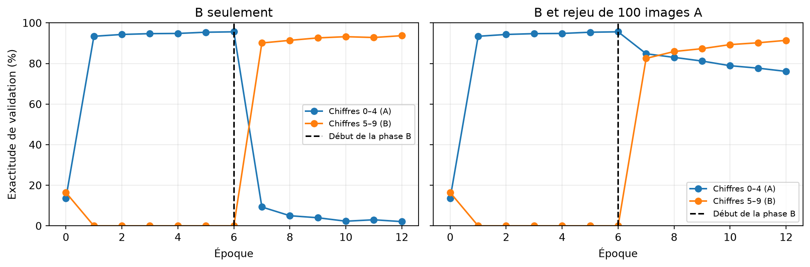
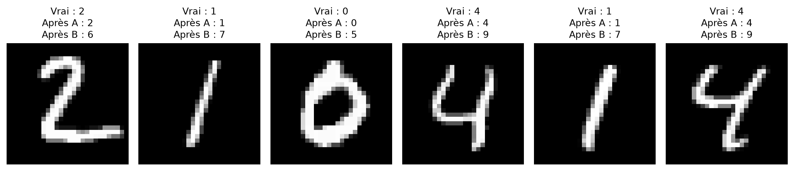

# Oubli catastrophique sur MNIST

Un complément à la présentation 14

Auteur·rice

Marcel Turcotte

Date de publication

31 octobre 2026

Un réseau peut apprendre une nouvelle tâche tout en perdant la capacité d’en résoudre une ancienne : c’est le phénomène d’**oubli catastrophique** (*catastrophic forgetting*). Ce carnet entraîne un petit perceptron multicouche (MLP) sur les chiffres MNIST **0–4**, puis **5–9**. Nous mesurons les deux capacités et comparons l’entraînement sur les nouvelles données seulement au rejeu d’une petite mémoire d’anciens exemples d’entraînement (*replay*).

Cet exemple prolonge la discussion de la présentation 14 sur les difficultés d’entraînement. Le modèle conserve une seule couche de sortie fixe à **dix logits**; les étiquettes des chiffres gardent leurs valeurs d’origine. À l’évaluation, les dix classes sont en concurrence. C’est une forme simple d’**apprentissage incrémental par classes** (*class-incremental learning*), plutôt qu’une évaluation qui indique au modèle parmi quels cinq chiffres choisir. Voir [van de Ven et Tolias (2019)](https://arxiv.org/abs/1904.07734).

## Données et budget d’entraînement reproductible

Nous utilisons la séparation officielle de MNIST entre entraînement et test. Pour une expérience rapide, chaque chiffre fournit 1 000 images d’entraînement et 200 de validation, toutes issues de la partition officielle d’entraînement. Les images du test officiel ne servent pas au choix des réglages. La première exécution télécharge MNIST avec Keras si les données ne sont pas déjà en cache.

Les graines fixent les réglages d’initialisation et d’échantillonnage. Les résultats exacts peuvent quand même varier selon le moteur de calcul et le matériel; il faut interpréter l’oubli et la rétention mesurés dans l’exécution réalisée, plutôt qu’attendre des pourcentages identiques sur tous les systèmes.

``` python
import numpy as np
import matplotlib.pyplot as plt
import keras

SEED = 42
EPOCHS = 6
STEPS_PER_EPOCH = 40
BATCH_SIZE = 128
LEARNING_RATE = 0.1

keras.utils.set_random_seed(SEED)
(images, labels), (test_images, test_labels) = keras.datasets.mnist.load_data()
data_rng = np.random.default_rng(SEED)
train_indices, validation_indices = [], []
for digit in range(10):
    indices = data_rng.permutation(np.flatnonzero(labels == digit))
    train_indices.extend(indices[:1000])
    validation_indices.extend(indices[1000:1200])

train_images, train_labels = images[train_indices], labels[train_indices]
validation_images = images[validation_indices]
validation_labels = labels[validation_indices]
train_a = (train_images[train_labels < 5], train_labels[train_labels < 5])
train_b = (train_images[train_labels >= 5], train_labels[train_labels >= 5])
validation_a = (validation_images[validation_labels < 5], validation_labels[validation_labels < 5])
validation_b = (validation_images[validation_labels >= 5], validation_labels[validation_labels >= 5])
```

## Un modèle, dix classes possibles

La couche cachée utilise ReLU et la sortie est linéaire. `SparseCategoricalCrossentropy(from_logits=True)` reçoit directement les logits et accepte des étiquettes de chiffres entières. Softmax convertirait les logits en probabilités; `argmax` donne la même classe prédite avant ou après softmax.

SGD utilise un taux d’apprentissage constant, sans momentum ni régularisation. La comparaison porte ainsi sur les données fournies pendant la seconde phase.

``` python
def compile_model(model):
    model.compile(optimizer=keras.optimizers.SGD(learning_rate=LEARNING_RATE),
                  loss=keras.losses.SparseCategoricalCrossentropy(from_logits=True))

def make_model():
    model = keras.Sequential([
        keras.layers.Input(shape=(28, 28)),
        keras.layers.Rescaling(1/255),
        keras.layers.Flatten(),
        keras.layers.Dense(128, activation='relu', kernel_initializer='he_normal'),
        keras.layers.Dense(10)
    ])
    compile_model(model)
    return model

def predicted_classes(model, x):
    logits = keras.ops.convert_to_numpy(model(x, training=False))
    return logits.argmax(axis=1)

def validation_accuracy(model):
    return [np.mean(predicted_classes(model, x) == y)
            for x, y in (validation_a, validation_b)]
```

## La même boucle d’entraînement, avec ou sans mémoire

Chaque phase a le même nombre de mises à jour et la même taille de lot. L’échantillonnage avec remise rend ce budget explicite. Sans mémoire, chaque lot ne contient que des exemples de la nouvelle tâche. Avec mémoire, la moitié du lot provient de la nouvelle tâche et l’autre moitié des anciens exemples conservés. Le rejeu modifie donc le mélange des données dans ce budget fixe.

L’historique retourné consigne l’exactitude de validation des deux groupes avant l’entraînement et après chaque époque. `train_on_batch` effectue le passage avant, le calcul des gradients et la mise à jour SGD; le code NumPy ne fait que constituer les lots.

``` python
def train_phase(model, training_data, seed, memory=None):
    rng = np.random.default_rng(seed)
    x, y = training_data
    history = [validation_accuracy(model)]
    new_count = BATCH_SIZE if memory is None else BATCH_SIZE // 2
    for epoch in range(EPOCHS):
        for _ in range(STEPS_PER_EPOCH):
            indices = rng.integers(len(y), size=new_count)
            xb, yb = x[indices], y[indices]
            if memory is not None:
                old_x, old_y = memory
                old_indices = rng.integers(len(old_y), size=BATCH_SIZE-new_count)
                xb = np.concatenate([xb, old_x[old_indices]])
                yb = np.concatenate([yb, old_y[old_indices]])
            model.train_on_batch(xb, yb)
        history.append(validation_accuracy(model))
    return np.asarray(history)
```

## Phase A : apprendre les chiffres 0–4

``` python
sequential_model = make_model()
history_a = train_phase(sequential_model, train_a, seed=101)
weights_after_a = [weight.copy() for weight in sequential_model.get_weights()]
test_predictions_after_a = predicted_classes(sequential_model, test_images)
print('Exactitude de validation après A :')
print(f'  chiffres 0–4 : {history_a[-1, 0]:.1%}')
print(f'  chiffres 5–9 : {history_a[-1, 1]:.1%}')
```

    Exactitude de validation après A :
      chiffres 0–4 : 95.6%
      chiffres 5–9 : 0.0%

Une faible performance sur les chiffres 5–9 est normale à ce stade : ils n’ont pas encore été des cibles d’entraînement. La référence pour mesurer l’oubli est la performance sur les chiffres 0–4 **après l’apprentissage de A**.

## Phase B : nouvelles données seules ou rejeu

La branche séquentielle continue avec ses paramètres appris. La branche avec rejeu part d’une copie identique de ces paramètres. Les deux branches utilisent un nouvel optimiseur SGD avec le même taux d’apprentissage constant; recompiler la branche séquentielle ne réinitialise pas les poids du modèle.

La mémoire conserve vingt images d’entraînement par ancienne classe, soit cent images au total. Aucune image de validation ou de test n’y est placée. Les deux branches ont le même nombre de mises à jour de phase B.

``` python
memory_rng = np.random.default_rng(202)
memory_indices = np.concatenate([
    memory_rng.choice(np.flatnonzero(train_a[1] == digit), size=20, replace=False)
    for digit in range(5)
])
memory = (train_a[0][memory_indices], train_a[1][memory_indices])

replay_model = make_model()
replay_model.set_weights(weights_after_a)
compile_model(sequential_model)
history_b = train_phase(sequential_model, train_b, seed=303)
history_replay = train_phase(replay_model, train_b, seed=303, memory=memory)
```

## Suivre les deux capacités

``` python
fig, axes = plt.subplots(1, 2, figsize=(11, 3.7), sharey=True)
for ax, continuation, title in zip(axes, (history_b, history_replay),
                                  ('B seulement', 'B et rejeu de 100 images A')):
    history = np.vstack([history_a, continuation[1:]])
    epochs = np.arange(len(history))
    ax.plot(epochs, 100*history[:, 0], 'o-', label='Chiffres 0–4 (A)')
    ax.plot(epochs, 100*history[:, 1], 'o-', label='Chiffres 5–9 (B)')
    ax.axvline(EPOCHS, color='black', linestyle='--', label='Début de la phase B')
    ax.set(title=title, xlabel='Époque', ylim=(0, 100), xticks=np.arange(0, 2*EPOCHS+1, 2))
    ax.grid(alpha=0.25)
    ax.legend(fontsize=8)
axes[0].set_ylabel('Exactitude de validation (%)')
fig.tight_layout()
fig.savefig('catastrophic_forgetting_accuracy.png', dpi=150, bbox_inches='tight')
plt.show()
```



Les deux panneaux partagent le même historique de phase A. La seconde phase doit être lue selon deux questions : le modèle apprend-il B et quelle part de A conserve-t-il? Les courbes de validation décrivent cette expérience fixe; elles ne servent pas ici à choisir des hyperparamètres ou un moment d’arrêt.

Le rejeu réduit l’oubli dans cette expérience, sans l’éliminer. Une partie du budget fixe de mises à jour de phase B est consacrée à A; il faut donc considérer à la fois la rétention et la performance sur la nouvelle tâche pour comparer les branches.

## Mesures en fin de phase sur le test officiel

Rapporter les groupes séparément : une exactitude globale peut masquer une forte perte d’une capacité antérieure. Les dix classes de sortie restent disponibles pour chaque prédiction.

``` python
test_predictions_sequential = predicted_classes(sequential_model, test_images)
test_predictions_replay = predicted_classes(replay_model, test_images)
mask_a = test_labels < 5

def group_accuracies(predictions):
    correct = predictions == test_labels
    return np.array([correct[mask_a].mean(), correct[~mask_a].mean(), correct.mean()])

test_results = {
    'Après A': group_accuracies(test_predictions_after_a),
    'Après B seulement': group_accuracies(test_predictions_sequential),
    'Après B avec rejeu': group_accuracies(test_predictions_replay)
}
print(f"{'Point de sauvegarde':<22} {'A (0–4)':>10} {'B (5–9)':>10} {'Tous chiffres':>12}")
for name, values in test_results.items():
    print(f'{name:<22}' + ''.join(f'{100*value:>10.1f}%' for value in values))
for name in ('Après B seulement', 'Après B avec rejeu'):
    forgetting_pp = 100*(test_results['Après A'][0]-test_results[name][0])
    print(f'Baisse sur A, {name} : {forgetting_pp:.1f} points de pourcentage')
```

    Point de sauvegarde       A (0–4)    B (5–9) Tous chiffres
    Après A                     97.1%       0.0%      49.9%
    Après B seulement            2.3%      93.9%      46.8%
    Après B avec rejeu          79.8%      91.4%      85.4%
    Baisse sur A, Après B seulement : 94.8 points de pourcentage
    Baisse sur A, Après B avec rejeu : 17.3 points de pourcentage

Ces mesures comparent des points de sauvegarde prédéfinis. Les prédictions de test de phase A ont été consignées avant l’entraînement de phase B et ne sont pas recalculées avec les paramètres ultérieurs.

## Les mêmes images, des prédictions différentes

``` python
forgotten = np.flatnonzero(mask_a & (test_predictions_after_a == test_labels)
                           & (test_predictions_sequential != test_labels))[:6]
if len(forgotten):
    fig, axes = plt.subplots(1, len(forgotten), figsize=(2*len(forgotten), 2.6), squeeze=False)
    for ax, index in zip(axes[0], forgotten):
        ax.imshow(test_images[index], cmap='gray')
        ax.set_title(f'Vrai : {test_labels[index]}\nAprès A : {test_predictions_after_a[index]}\nAprès B : {test_predictions_sequential[index]}', fontsize=10)
        ax.axis('off')
    fig.tight_layout()
    plt.show()
else:
    print('Aucune image A correctement prédite au départ n\'est devenue incorrecte dans cette exécution.')
```



Les entrées et leurs étiquettes n’ont pas changé. Les paramètres ont changé pendant la poursuite de l’entraînement. Dans cet exemple aux classes disjointes, la baisse peut comprendre un fort biais vers les classes récentes et des changements des représentations partagées; elle ne prouve pas que toutes les anciennes représentations utiles ont été effacées.

## Quelles conséquences pour les modèles déployés?

Faire une prédiction avec un modèle entraîné laisse habituellement ses poids fixes. L’apprentissage exige un processus explicite de mise à jour. L’oubli catastrophique peut survenir pendant l’apprentissage en ligne (*online learning*) ou l’ajustement fin (*fine-tuning*) périodique par lots, lorsque les nouvelles mises à jour ne protègent pas le comportement antérieur.

Des réseaux en production peuvent apprendre en ligne; [Monolith](https://arxiv.org/abs/2209.07663) est un exemple de recommandation en temps réel. Il faut donc concevoir et évaluer soigneusement les mises à jour, plutôt que conclure que l’apprentissage en ligne serait impossible. La [discussion de Google sur les systèmes d’apprentissage en production](https://developers.google.com/machine-learning/crash-course/production-ml-systems/static-vs-dynamic-training) distingue l’entraînement statique et dynamique.

Le rejeu réintroduit explicitement un objectif sur les anciennes données. L2 habituelle centrée en zéro pénalise les grands poids; elle ne préserve pas explicitement les prédictions déjà apprises. Des méthodes comme la [consolidation élastique des poids](https://arxiv.org/abs/1612.00796) utilisent d’autres mécanismes pour protéger les acquis. Aucune méthode d’apprentissage continu n’est ici implémentée ou présentée comme universellement supérieure.

Pour réfléchir : pourquoi l’exactitude sur B peut-elle augmenter pendant que celle sur A diminue? Pourquoi la seule exactitude moyenne ne suffit-elle pas? Qu’est-ce qui change lorsque d’anciens exemples occupent une partie du budget fixe de mises à jour de phase B?

[Retour à la présentation 14](../../lectures/14/index.llms.md).
