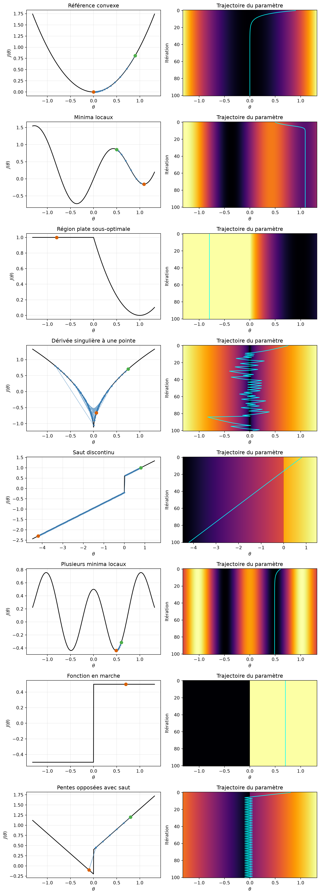
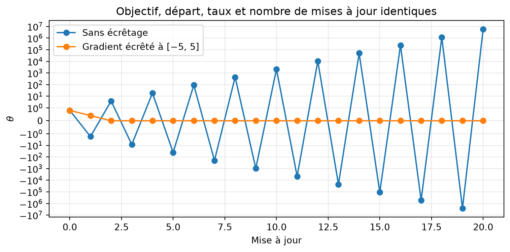
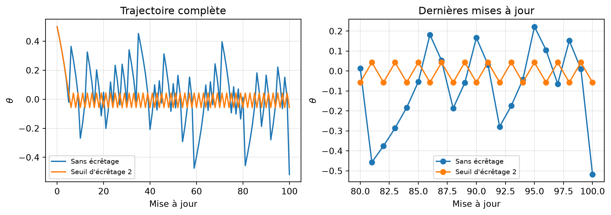

# Paysages de perte et descente de gradient

Un complément à la présentation 14

Auteur·rice

Marcel Turcotte

Date de publication

31 octobre 2026

La rétropropagation calcule un gradient. L’utilité de la mise à jour obtenue dépend aussi de la forme de la fonction objectif, des paramètres initiaux et du taux d’apprentissage. Ce carnet complète la présentation 14 avec des **paysages de perte** (*loss landscapes*) unidimensionnels que nous pouvons examiner entièrement.

La discussion s’inspire de [MIT 6.S191: Introduction to Deep Learning](https://www.youtube.com/playlist?list=PLUl4u3cNGP63URZnh5iqBzDTDYPUTQT-8); les fonctions et les expériences ci-dessous servent d’illustrations pédagogiques. Un réseau de neurones possède généralement de nombreux paramètres : ces graphiques représentent des situations simplifiées plutôt que des surfaces complètes de perte de réseaux.

## Suivre un gradient

La mise à jour est \theta\_{t+1}=\theta_t-\alpha J'(\theta_t). La fonction auxiliaire consigne les valeurs du paramètre sans écrêtage, sauf si un seuil est fourni explicitement. Si une fonction objectif délibérément non lisse n’a pas de dérivée finie à une itération, la trajectoire s’y arrête.

``` python
import numpy as np
import matplotlib.pyplot as plt

def gradient_descent_1d(gradient, start, learning_rate, steps, clip_value=None):
    trajectory = [float(start)]
    for _ in range(steps):
        g = float(gradient(trajectory[-1]))
        if not np.isfinite(g):
            break  # La fonction simplifiée n'a pas de dérivée finie ici.
        if clip_value is not None:
            g = np.clip(g, -clip_value, clip_value)
        trajectory.append(trajectory[-1] - learning_rate * g)
    return np.asarray(trajectory)

def plot_landscape(objective, trajectory, ax, title):
    left = min(-1.2, trajectory.min())
    right = max(1.2, trajectory.max())
    padding = 0.05 * (right - left)
    theta = np.linspace(left - padding, right + padding, 800)
    ax.plot(theta, objective(theta), color='black', linewidth=1.5)
    ax.plot(trajectory, objective(trajectory), 'o-', color='#377eb8',
            markersize=3, linewidth=0.8, alpha=0.65)
    ax.scatter(trajectory[0], objective(trajectory[0]), color='#4daf4a',
               s=45, zorder=4, label='Départ')
    ax.scatter(trajectory[-1], objective(trajectory[-1]), color='#d95f02',
               s=45, zorder=5, label='Fin')
    ax.set(title=title, xlabel=r'$\theta$', ylabel=r'$J(\theta)$')
    ax.grid(alpha=0.25)
    return theta
```

## Trois cas contrastés

L’exemple à région plate est J(\theta)=(\operatorname{ReLU}(\theta)-1)^2. Tout \theta négatif donne une perte de 1 et une dérivée nulle, mais \theta=1 donne une perte nulle. C’est une région plate sous-optimale, et non une fonction objectif constante partout. À zéro, la dérivée ordinaire n’est pas définie; cet exemple utilise la convention habituelle du gradient nul à travers ReLU.

``` python
fig, axes = plt.subplots(1, 3, figsize=(11, 3.2))
overview = [
    ('Référence convexe', lambda t: t**2, lambda t: 2*t, 0.9, 0.1),
    ('Minima locaux', lambda t: 0.8*np.sin(4*t)+0.5*t**2,
     lambda t: 3.2*np.cos(4*t)+t, 0.5, 0.05),
    ('Région plate sous-optimale', lambda t: (np.maximum(0, t)-1)**2,
     lambda t: 2*(t-1) if t > 0 else 0.0, -0.8, 0.1)
]
for ax, (title, objective, gradient, start, rate) in zip(axes, overview):
    trajectory = gradient_descent_1d(gradient, start, rate, steps=60)
    plot_landscape(objective, trajectory, ax, title)
axes[0].legend(fontsize=8)
fig.tight_layout()
plt.show()
```


L’exemple convexe approche son minimum. L’exemple non convexe atteint un minimum local déterminé par le point initial. La valeur initiale négative de l’exemple ReLU ne reçoit aucun signal de gradient pour quitter sa région plate. Un gradient nul ne garantit pas à lui seul une règle de prédiction globalement optimale.

En dimension supérieure, un point stationnaire peut aussi être un point de selle : la fonction objectif augmente dans certaines directions et diminue dans d’autres. Les illustrations unidimensionnelles ne peuvent montrer toute cette géométrie.

## Un atlas de fonctions objectif simplifiées

Les autres exemples comprennent une pointe, une marche et des sauts pour illustrer les cas où la différentiabilité ordinaire fait défaut. Les réseaux composés de transformations affines et d’activations continues comme ReLU produisent des prédictions continues; les exemples discontinus ci-dessous sont délibérément plus pathologiques.

``` python
def cusp_gradient(theta):
    if theta == 0:
        return np.nan
    return 1.1 * np.sign(theta) / np.sqrt(abs(theta))

scenarios = [
    dict(title='Référence convexe', objective=lambda t: t**2,
         gradient=lambda t: 2*t, start=0.9, learning_rate=0.1),
    dict(title='Minima locaux', objective=lambda t: 0.8*np.sin(4*t) + 0.5*t**2,
         gradient=lambda t: 3.2*np.cos(4*t) + t, start=0.5, learning_rate=0.05),
    dict(title='Région plate sous-optimale', objective=lambda t: (np.maximum(0, t)-1)**2,
         gradient=lambda t: 2*(t-1) if t > 0 else 0.0, start=-0.8, learning_rate=0.1),
    dict(title='Dérivée singulière à une pointe', objective=lambda t: 2.2*np.sqrt(np.abs(t))-1.2,
         gradient=cusp_gradient, start=0.75, learning_rate=0.05),
    dict(title='Saut discontinu', objective=lambda t: np.where(t < 0, 0.5*t-0.2, 0.5*t+0.6),
         gradient=lambda t: 0.5 if t != 0 else np.nan, start=0.8, learning_rate=0.1),
    dict(title='Plusieurs minima locaux', objective=lambda t: 0.5*np.cos(2*np.pi*t) + 0.25*t**2,
         gradient=lambda t: -np.pi*np.sin(2*np.pi*t) + 0.5*t, start=0.6, learning_rate=0.01),
    dict(title='Fonction en marche', objective=lambda t: np.where(t >= 0, 0.5, -0.5),
         gradient=lambda t: 0.0 if t != 0 else np.nan, start=0.7, learning_rate=0.1),
    dict(title='Pentes opposées avec saut', objective=lambda t: np.where(t < 0, -t-0.2, t+0.4),
         gradient=lambda t: -1.0 if t < 0 else (1.0 if t > 0 else np.nan),
         start=0.8, learning_rate=0.15)
]
```

``` python
fig, axes = plt.subplots(len(scenarios), 2, figsize=(10, 3.5*len(scenarios)))
for index, scenario in enumerate(scenarios):
    row, column = index, 0
    trajectory = gradient_descent_1d(scenario['gradient'], scenario['start'],
                                     scenario['learning_rate'], steps=100)
    theta = plot_landscape(scenario['objective'], trajectory, axes[row, column],
                           scenario['title'])
    iterations = np.arange(len(trajectory))
    values = np.broadcast_to(scenario['objective'](theta), (len(iterations), len(theta)))
    axes[row, column+1].pcolormesh(theta, iterations, values,
                                   cmap='inferno', shading='auto')
    axes[row, column+1].plot(trajectory, iterations, color='cyan', linewidth=1.2)
    axes[row, column+1].invert_yaxis()
    axes[row, column+1].set(title='Trajectoire du paramètre', xlabel=r'$\theta$', ylabel='Itération')
fig.tight_layout()
plt.show()
```



Chaque carte thermique répète la **même fonction objectif unidimensionnelle fixe** de haut en bas. L’axe horizontal représente le paramètre et l’axe vertical l’itération. Il ne s’agit pas d’une surface de perte à deux paramètres. Les limites des graphiques englobent la trajectoire consignée, y compris les excursions hors de l’intervalle initial.

La fonction avec saut et pente positive constante n’est pas bornée inférieurement. L’exemple aux pentes opposées possède une valeur limite inférieure non atteinte lorsqu’on approche zéro par la gauche. Ces exemples illustrent des hypothèses d’optimisation non satisfaites, sans affirmer que les pertes usuelles des réseaux possèdent toujours ces propriétés.

La fonction à pointe possède une dérivée non bornée près de zéro, où elle n’est pas définie. Il s’agit d’une **dérivée locale singulière**. Dans un réseau profond, les **gradients explosifs** (*exploding gradients*) peuvent plutôt résulter de produits de transformations pendant la rétropropagation; aucune dérivée d’activation individuelle n’a besoin d’être singulière.

## Écrêter le gradient d’une fonction à forte pente

Utilisons J(\theta)=20\theta^2, avec J'(\theta)=40\theta. Au taux d’apprentissage \alpha=0.08, la mise à jour sans écrêtage multiplie la valeur courante par -2.2; sa valeur absolue augmente donc. L’**écrêtage du gradient** (*gradient clipping*) scalaire à \[-5,5\] limite la taille de chaque mise à jour à 0.4.

``` python
steep_objective = lambda t: 20*t**2
steep_gradient = lambda t: 40*t
unclipped = gradient_descent_1d(steep_gradient, 0.8, 0.08, steps=20)
clipped = gradient_descent_1d(steep_gradient, 0.8, 0.08, steps=20, clip_value=5.0)

fig, ax = plt.subplots(figsize=(8, 4))
ax.plot(unclipped, 'o-', label='Sans écrêtage')
ax.plot(clipped, 'o-', label='Gradient écrêté à [−5, 5]')
ax.set_yscale('symlog', linthresh=1)
ax.set(xlabel='Mise à jour', ylabel=r'$\theta$', title='Objectif, départ, taux et nombre de mises à jour identiques')
ax.grid(alpha=0.3)
ax.legend()
fig.tight_layout()
plt.show()
```



L’axe logarithmique symétrique affiche de grandes valeurs positives et négatives tout en conservant la région près de zéro. L’écrêtage borne le pas; un taux d’apprentissage plus petit traiterait aussi ce cas quadratique. Dans un réseau, l’écrêtage par norme globale redimensionne le vecteur gradient lorsque sa norme dépasse un seuil.

## L’écrêtage ne garantit pas la convergence

La pointe de la fonction racine carrée fournit un contre-exemple : malgré l’écrêtage, une méthode à pas constant peut continuer d’osciller près du minimum. Comparons les deux trajectoires avec les mêmes réglages.

``` python
fig, axes = plt.subplots(1, 2, figsize=(10, 3.6))
for threshold, label in [(None, 'Sans écrêtage'), (2.0, 'Seuil d\'écrêtage 2')]:
    trajectory = gradient_descent_1d(cusp_gradient, 0.5, 0.05, steps=100,
                                     clip_value=threshold)
    axes[0].plot(trajectory, label=label)
    axes[1].plot(np.arange(80, len(trajectory)), trajectory[80:], 'o-', label=label)
axes[0].set(title='Trajectoire complète', xlabel='Mise à jour', ylabel=r'$\theta$')
axes[1].set(title='Dernières mises à jour', xlabel='Mise à jour', ylabel=r'$\theta$')
for ax in axes:
    ax.grid(alpha=0.3)
    ax.legend(fontsize=8)
fig.tight_layout()
plt.show()
```



Des mises à jour bornées n’approchent pas nécessairement un minimum. Le taux d’apprentissage et son évolution restent importants. L’écrêtage ne restaure pas un gradient évanescent, ne supprime pas les minima locaux et ne rend pas différentiable une fonction discontinue.

Pour réfléchir : quelles trajectoires s’arrêtent parce que leurs gradients sont nuls, lesquelles dépendent du point initial et lesquelles échouent parce que la mise à jour est trop grande?

[Retour à la présentation 14](../../lectures/14/index.llms.md).
