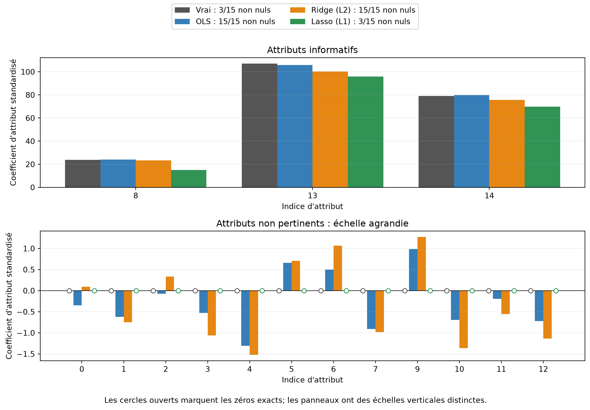

# Régularisation : réduction des coefficients et parcimonie

Un complément à la présentation 14

Auteur·rice

Marcel Turcotte

Date de publication

31 octobre 2026

Ce carnet isole l’effet des pénalités L1 et L2 au carré en régression linéaire. Les vrais coefficients des données synthétiques sont connus; nous pouvons donc les comparer à ceux des moindres carrés ordinaires (OLS), de Ridge et de Lasso. OLS sert de référence sans régularisation; Ridge et Lasso appliquent respectivement L2 et L1. La présentation 14 applique les mêmes idées de pénalité aux poids des réseaux de neurones.

L’objectif est de distinguer la **réduction des coefficients** (*shrinkage*) de la **parcimonie** (*sparsity*). Cette expérience ne détermine pas quel estimateur prédit le mieux sur de nouvelles données.

## Données et modèles

Quinze **attributs** (*features*) sont générés, mais seuls trois ont un vrai coefficient non nul. Avant l’ajustement, la **standardisation** (*standardization*) donne à chaque attribut une moyenne empirique nulle et une variance empirique unitaire. Les attributs générés ont déjà des échelles comparables : la standardisation change donc peu les résultats numériques ici, mais elle explicite l’hypothèse de prétraitement.

``` python
import numpy as np
import matplotlib.pyplot as plt
from sklearn.datasets import make_regression
from sklearn.linear_model import LinearRegression, Ridge, Lasso
from sklearn.preprocessing import StandardScaler

X, y, true_coef = make_regression(n_samples=200, n_features=15, n_informative=3,
                                 noise=10.0, coef=True, random_state=42)
scaler = StandardScaler()
X_scaled = scaler.fit_transform(X)

# Exprimer les coefficients connus dans les mêmes coordonnées que les modèles ajustés.
true_coef_scaled = true_coef * scaler.scale_
coefficient_models = {
    'OLS': LinearRegression().fit(X_scaled, y),
    'Ridge (L2)': Ridge(alpha=10.0).fit(X_scaled, y),
    'Lasso (L1)': Lasso(alpha=10.0).fit(X_scaled, y)
}
```

## Pourquoi standardiser?

Les unités des attributs influencent les pénalités des coefficients. Multiplier les valeurs d’un attribut par 100 permet de diviser son coefficient par 100 en préservant les prédictions, mais change la pénalité de ce coefficient. La standardisation place les pénalités sur une échelle commune entre les attributs. Elle ne crée pas elle-même la parcimonie associée à L1. Voir la [documentation de StandardScaler](https://scikit-learn.org/stable/modules/generated/sklearn.preprocessing.StandardScaler.html).

Pour un attribut transformé par x'\_j=(x_j-\mu_j)/s_j, le coefficient en coordonnées standardisées est w'\_j=s_jw_j. Le centrage est absorbé par l’ordonnée à l’origine ajustée. Le graphique et le tableau comparent les **vrais coefficients et les estimations dans ces mêmes coordonnées standardisées** : chaque coefficient décrit la variation prédite de la cible pour une augmentation d’un écart-type de son attribut, tous les autres attributs étant maintenus fixes.

Toutes les observations générées servent à l’entraînement dans cette démonstration sur les coefficients. Pour évaluer les prédictions sur des données réservées, ajuster le standardiseur uniquement sur l’entraînement, puis l’utiliser pour transformer la validation et le test; un pipeline scikit-learn conserve ce prétraitement avec le modèle.

## Comparer les coefficients

Les attributs informatifs et non pertinents utilisent des **échelles verticales distinctes**. L’échelle agrandie du panneau inférieur rend visibles les petits coefficients non nuls. Les cercles ouverts indiquent les coefficients exactement nuls, mesurés avant l’arrondi d’affichage.

``` python
series = [('Vrai', true_coef_scaled)] + [
    (name, fitted.coef_) for name, fitted in coefficient_models.items()
]
colors = ['#555555', '#377eb8', '#e68613', '#319354']
groups = [
    (true_coef != 0, 'Attributs informatifs'),
    (true_coef == 0, 'Attributs non pertinents : échelle agrandie')
]
fig, axes = plt.subplots(2, 1, figsize=(11, 7.5))
for ax, (mask, title) in zip(axes, groups):
    feature_indices = np.flatnonzero(mask)
    positions = np.arange(len(feature_indices))
    for offset, ((name, values), color) in enumerate(zip(series, colors)):
        x_positions = positions + (offset-1.5)*0.2
        nonzero = np.count_nonzero(values)
        ax.bar(x_positions, values[mask], width=0.2, color=color,
               label=f'{name} : {nonzero}/15 non nuls')
        zeros = values[mask] == 0
        ax.scatter(x_positions[zeros], values[mask][zeros], s=35,
                   facecolors='white', edgecolors=color, zorder=4)
    ax.set(xticks=positions, xticklabels=feature_indices, xlabel="Indice d'attribut",
           ylabel="Coefficient d'attribut standardisé", title=title)
    ax.axhline(0, color='black', linewidth=0.7)
    ax.grid(axis='y', alpha=0.2)
handles, labels = axes[0].get_legend_handles_labels()
fig.legend(handles, labels, loc='upper center', ncol=2)
fig.text(0.5, 0.01, 'Les cercles ouverts marquent les zéros exacts; les panneaux ont des échelles verticales distinctes.',
         ha='center')
fig.tight_layout(rect=(0, 0.035, 1, 0.91))
plt.show()
```



``` python
print(f"{'Attribut':<9} {'Vrai':>10} {'OLS':>10} {'Ridge':>10} {'Lasso':>10}")
for index, value in enumerate(true_coef_scaled):
    estimates = [fitted.coef_[index] for fitted in coefficient_models.values()]
    print(f"{index:<9} {value:>10.2f}" + ''.join(f'{estimate:>10.2f}' for estimate in estimates))

print('\nDécomptes et parcimonie, avant arrondi : ')
print(f"{'Estimateur':<12} {'Non nuls':>9} {'Nuls exacts':>14} {'Parcimonie':>11}")
for name, fitted in coefficient_models.items():
    nonzero = np.count_nonzero(fitted.coef_)
    zeros = len(fitted.coef_) - nonzero
    sparsity = 100*zeros/len(fitted.coef_)
    print(f'{name:<12} {nonzero:>9} {zeros:>14} {sparsity:>10.1f}%')
print('Vrais indices informatifs :', np.flatnonzero(true_coef))
print('Indices non nuls de Lasso : ', np.flatnonzero(coefficient_models['Lasso (L1)'].coef_))
```

    Attribut        Vrai        OLS      Ridge      Lasso
    0               0.00     -0.35      0.09      0.00
    1               0.00     -0.62     -0.75     -0.00
    2               0.00     -0.07      0.33      0.00
    3               0.00     -0.53     -1.06     -0.00
    4               0.00     -1.31     -1.52     -0.00
    5               0.00      0.66      0.71      0.00
    6               0.00      0.50      1.07      0.00
    7               0.00     -0.91     -0.98     -0.00
    8              23.71     24.13     23.25     15.02
    9               0.00      0.98      1.27      0.00
    10              0.00     -0.70     -1.36     -0.00
    11              0.00     -0.19     -0.55     -0.00
    12              0.00     -0.72     -1.13     -0.00
    13            106.95    105.85    100.34     95.86
    14             79.06     79.87     75.69     69.79

    Décomptes et parcimonie, avant arrondi : 
    Estimateur    Non nuls    Nuls exacts  Parcimonie
    OLS                 15              0        0.0%
    Ridge (L2)          15              0        0.0%
    Lasso (L1)           3             12       80.0%
    Vrais indices informatifs : [ 8 13 14]
    Indices non nuls de Lasso :  [ 8 13 14]

Avec ces réglages fixes, OLS et Ridge conservent quinze coefficients non nuls et Lasso en conserve trois, soit 80 % de zéros exacts. Ici, Lasso choisit les trois attributs informatifs. Cet exemple de **sélection d’attributs** (*feature selection*) ne garantit pas la récupération des vrais attributs dans d’autres jeux de données, notamment lorsque les prédicteurs sont corrélés.

L2 favorise collectivement de plus petits poids et conserve généralement une solution dense. Elle pénalise la somme des carrés des coefficients; un coefficient individuel n’est pas nécessairement plus petit que son estimation OLS lorsque les prédicteurs sont corrélés. Même des attributs générés indépendamment présentent certaines corrélations dans un échantillon fini.

L1 favorise la parcimonie : le point anguleux de la pénalité de valeur absolue à zéro permet à l’optimum de comporter des coefficients exactement nuls, et le solveur de Lasso par descente de coordonnées peut trouver ces solutions parcimonieuses. Ces zéros proviennent du problème d’optimisation. L’arrondi d’affichage ne sert pas à décider si un coefficient est nul. Voir le [guide de Lasso](https://scikit-learn.org/stable/modules/linear_model.html#lasso).

## Que signifient les coefficients de pénalité?

Les deux valeurs `alpha=10` ont été choisies pour une démonstration qualitative. Elles ne représentent pas des pénalités de même intensité. [Ridge](https://scikit-learn.org/stable/modules/generated/sklearn.linear_model.Ridge.html) minimise

\\y-Xw\\\_2^2+\alpha\\w\\\_2^2,

tandis que [Lasso](https://scikit-learn.org/stable/modules/generated/sklearn.linear_model.Lasso.html) minimise

\frac{1}{2N}\\y-Xw\\\_2^2+\alpha\\w\\\_1.

Ici, X désigne la matrice des attributs standardisés et w leurs coefficients. L’ordonnée à l’origine ajustée est omise de ces expressions compactes et n’est pas pénalisée. Les normalisations de perte et les définitions de pénalité diffèrent; il faut donc interpréter les coefficients de différentes API avant de les comparer.

## Lien avec les réseaux de neurones

La même idée s’applique aux entrées des matrices de poids d’un réseau. Dans `SimpleMLP`, la fonction objectif est la BCE moyenne plus \lambda/2 fois la somme des carrés des poids, et le gradient ajouté est \lambda W. Les biais ne sont pas pénalisés.

L1 favorise des connexions parcimonieuses dans un réseau, mais les mises à jour ordinaires par gradient ne donnent pas nécessairement des zéros exacts. Un attribut d’entrée n’est entièrement déconnecté que si tous ses poids sortants sont nuls; une connexion nulle isolée ne démontre pas sa suppression.

## Ce que cette expérience établit

Les figures illustrent la réduction des coefficients et la parcimonie. Les trois estimateurs conservent des nombres différents d’attributs; des coefficients visuellement proches sur les attributs informatifs n’établissent pas des performances prédictives égales. Un modèle plus parcimonieux ne prédit pas automatiquement mieux.

Pour comparer les prédictions sur de nouveaux exemples, utiliser des jeux d’entraînement, de validation et de test distincts, choisir la pénalité de chaque estimateur avec la validation et rapporter les erreurs finales au test. Une régularisation trop forte peut causer du sous-apprentissage. Ici, les valeurs fixes de pénalité servent la démonstration des coefficients et n’ont pas été choisies pour l’exactitude prédictive.

[Retour à la présentation 14](../../lectures/14/index.llms.md).
