# Introduction aux algorithmes de recherche

CSI 4506

Auteur·rice

Marcel Turcotte

Date de publication

Version: nov. 3, 2026 14h13

# Préambule

## Message du jour

[David Silver and Lasse Espeholt of Ineffable Intelligence: A Superlearner for the Age of Experience](https://www.youtube.com/watch?v=L4SWQebqhek), publié sur la chaîne YouTube de Sequoia Capital le 2026-10-13.

David Silver a dirigé les recherches de DeepMind à l’origine d’AlphaGo, le premier système d’IA à vaincre un joueur professionnel de Go, et de ses successeurs, AlphaZero et MuZero. Il est aussi professeur d’informatique à l’University College London et membre de la Royal Society. Ses travaux relient les méthodes fondées sur les réseaux neuronaux présentées plus tôt dans le cours aux méthodes de recherche introduites ici. Son [site personnel](https://www.davidsilver.uk/) présente sa biographie actuelle.

## Objectifs d’apprentissage

- **Décrire** le rôle des algorithmes de recherche en IA, essentiel pour la planification, le raisonnement, et des applications telles qu’AlphaGo.
- **Formuler** un problème de recherche à l’aide d’états, d’un état initial, d’états objectifs, d’actions, d’un modèle de transition et de coûts d’action.
- **Distinguer** les états des nœuds de recherche, et les états atteints des nœuds de la frontière et des nœuds développés.
- **Implémenter** BFS et DFS, les **comparer** en utilisant le problème du puzzle à 8 tuiles.
- **Expliquer** la complétude, l’optimalité en coût et les besoins en mémoire de BFS et DFS selon des hypothèses explicites.

Cette présentation motive l’étude des méthodes de recherche en intelligence artificielle et établit le vocabulaire de cette partie du cours. La recherche en largeur et la recherche en profondeur fournissent des points de comparaison familiers pour étudier la représentation d’un problème, la sélection des nœuds et l’intérêt de méthodes plus sélectives. Cette partie du cours couvre les thèmes suivants :

- Recherche non informée
- Recherche informée
- Recherche locale
- Métaheuristiques à population
- Recherche adversariale
- Recherche arborescente de Monte-Carlo

Ces méthodes fournissent aussi une base pour le raisonnement formel, où la recherche peut explorer des déductions possibles ou des solutions candidates.

# Justification

## Justification

[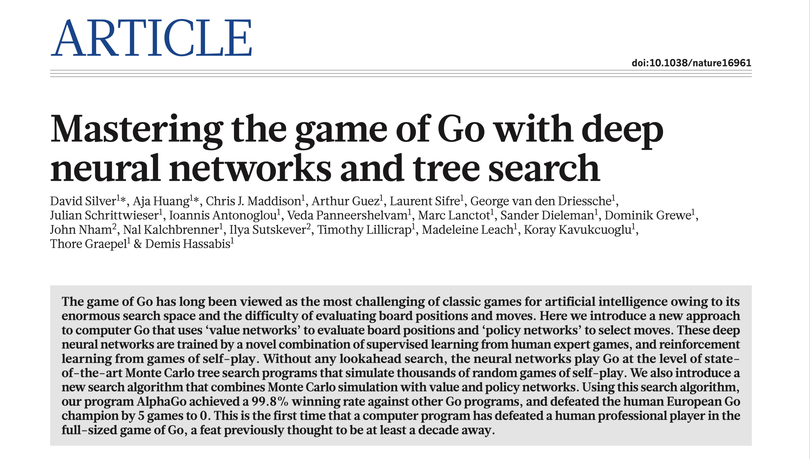](../../assets/images/AlphaGo-Nature-2016.png)

Silver et al. ([2016](#ref-Silver:2016aa))

## Justification

Nous avons perfectionné notre expertise en **apprentissage automatique** au point de bien comprendre les **réseaux neuronaux** et l’**apprentissage profond**, ce qui nous permet de développer des modèles simples avec **Keras**.

. . .

Ces dernières années, la **recherche arborescente de Monte-Carlo (MCTS)** a joué un rôle central dans les avancées de la recherche en **intelligence artificielle**. Après nous être concentrés sur l’apprentissage profond, **nous nous tournons maintenant vers la recherche**.

## Justification

L’intégration de l’**apprentissage profond** et de **MCTS** sous-tend des applications modernes comme **[AlphaGo](https://deepmind.google/research/breakthroughs/alphago/)**, **[AlphaZero](https://deepmind.google/discover/blog/alphazero-shedding-new-light-on-chess-shogi-and-go/)**, et **[MuZero](https://deepmind.google/discover/blog/muzero-mastering-go-chess-shogi-and-atari-without-rules/)**.

. . .

Les algorithmes de recherche sont donc cruciaux pour la **planification** et le **raisonnement** et leur importance devrait croître avec les avancées technologiques.

## Recherche (un historique biaisé)

- **1968 – A\*** : Recherche heuristique de chemins de coût minimal.
- **Années 1970–1980 – Algorithmes à population** (p. ex., algorithmes génétiques) : Recherche stochastique à population pour l’optimisation.
- **Années 1980 – Problèmes de satisfaction de contraintes (CSP)** : Progrès dans la combinaison de la propagation de contraintes et de la recherche avec retour en arrière.
- **2013 – DQN** : Apprentissage des valeurs d’action directement à partir des pixels par Q-learning profond.
- **2015 – AlphaGo** : Des réseaux neuronaux profonds guident MCTS ; première victoire en match contre un joueur professionnel de Go.
- **2017 – AlphaZero** : Apprentissage par autojeu avec MCTS guidée par des réseaux neuronaux pour les échecs, le shogi et le Go.
- **2019 – MuZero** : Planification avec un modèle appris, sans fournir au système la dynamique de l’environnement.
- **2020 – Agent57** : Apprentissage profond par renforcement avec exploration dirigée et sélection adaptative de politiques dans 57 jeux Atari.
- **2023 – FunSearch** : Recherche évolutionnaire sur des programmes proposés par un grand modèle de langage et évalués automatiquement.
- **2024 – AlphaGeometry** : Démonstration de théorèmes de géométrie combinant un modèle de langage neuronal et la déduction symbolique.

Cet historique présente une sélection de jalons de la recherche et de méthodes d’apprentissage connexes. DQN et Agent57 apprennent à agir par renforcement ; ils n’effectuent pas la recherche arborescente explicite sur des actions futures utilisée par AlphaGo, AlphaZero et MuZero. L’exploration pendant l’apprentissage et la recherche parmi des séquences d’actions futures sont deux idées distinctes.

Les dates correspondent à des jalons choisis, pas nécessairement aux dates de publication dans des revues. AlphaGo a battu Fan Hui en octobre 2015, avant sa publication dans Nature en janvier 2016. AlphaZero et MuZero sont apparus sous forme de prépublications en 2017 et 2019, respectivement. Les entrées sur les méthodes à population et les CSP désignent des périodes de développement plutôt que les origines de ces domaines.

Sources : Hart et al. ([1968](#ref-Hart:1968aa)) ; [livre de Holland, 1975](https://doi.org/10.7551/MITPRESS/1090.001.0001) ; [algorithmes de cohérence des contraintes, 1985](https://www.cs.ubc.ca/~mack/Publications/AI85.pdf) ; [DQN, 2013](https://arxiv.org/abs/1312.5602) ; [AlphaZero, 2017](https://arxiv.org/abs/1712.01815) ; [MuZero, 2019](https://arxiv.org/abs/1911.08265) ; [Agent57, 2020](https://arxiv.org/abs/2003.13350) ; [FunSearch, 2023](https://deepmind.google/blog/funsearch-making-new-discoveries-in-mathematical-sciences-using-large-language-models/) ; [AlphaGeometry, 2024](https://deepmind.google/blog/alphageometry-an-olympiad-level-ai-system-for-geometry/).

## Recherche

[](https://youtu.be/g-dKXOlsf98)

[L’ordinateur qui a maîtrisé le jeu de Go](https://youtu.be/g-dKXOlsf98). [Nature Video](https://www.youtube.com/@NatureVideoChannel) YouTube le 27-01-2016. **Vidéo présentée en classe** (7**m** 52**s**).

**Question de visionnement :** Comment les connaissances apprises peuvent-elles aider à choisir les coups à explorer et à évaluer une position ?

En 1997, le Deep Blue d’IBM a vaincu le champion du monde d’échecs en titre, Garry Kasparov. Il pouvait évaluer 200 millions de positions par seconde, en combinant calcul rapide, recherche sélective, ordonnancement des coups et évaluation soigneusement conçue. Dans une [réflexion ultérieure](https://www.kasparov.com/i-was-there-when-ai-mastered-chess-mit-technology-review-october-6-2022/), Kasparov l’a décrit comme étant « aussi intelligent que votre réveil » \[traduction\]. Ce commentaire oppose la performance dans une tâche particulière à l’intelligence générale ; il ne signifie pas que Deep Blue était dépourvu d’algorithmes de recherche sophistiqués. Voir [l’historique d’IBM](https://www.ibm.com/history/deep-blue) et [la présentation technique de ses concepteurs](https://cdn.aaai.org/Symposia/Spring/1999/SS-99-07/SS99-07-004.pdf).

La vidéo de Nature explique comment les connaissances apprises rendent la recherche au Go sélective : un réseau de politique suggère des coups prometteurs et un réseau de valeur estime la qualité des positions. La recherche combine ces estimations avec l’exploration de suites possibles. Plus tard, AlphaZero a appris par autojeu et a combiné une évaluation apprise avec MCTS. Kasparov a déclaré : « Je ne peux dissimuler ma satisfaction de le voir jouer dans un style très dynamique, semblable au mien ! » \[traduction\]. Voir [l’article de Google DeepMind sur AlphaZero](https://deepmind.google/blog/alphazero-shedding-new-light-on-chess-shogi-and-go/).

Le lien essentiel est que l’apprentissage et la recherche se complètent. Cette présentation établit le vocabulaire et les méthodes de recherche de référence ; la présentation 22 examine MCTS en détail.

## AlphaGo - Le Film

[](https://youtu.be/WXuK6gekU1Y)

Oui, **AlphaGo** a battu le champion de Go Lee **Sedol**, 4–1 en mars 2016. Le documentaire complet suit ce match. (1**h** 30**m**)

[AlphaGo - The Movie \| Full award-winning documentary](https://youtu.be/WXuK6gekU1Y), Google DeepMind, 2020-03-13.

La vidéo de Nature précède le match contre Lee Sedol : elle présente la victoire d’AlphaGo, 5–0 contre le joueur professionnel Fan Hui en octobre 2015. Le documentaire est une ressource complémentaire sur le match ultérieur. Voir [l’historique d’AlphaGo de Google DeepMind](https://deepmind.google/research/alphago/).

## AlphaGo2MuZero

[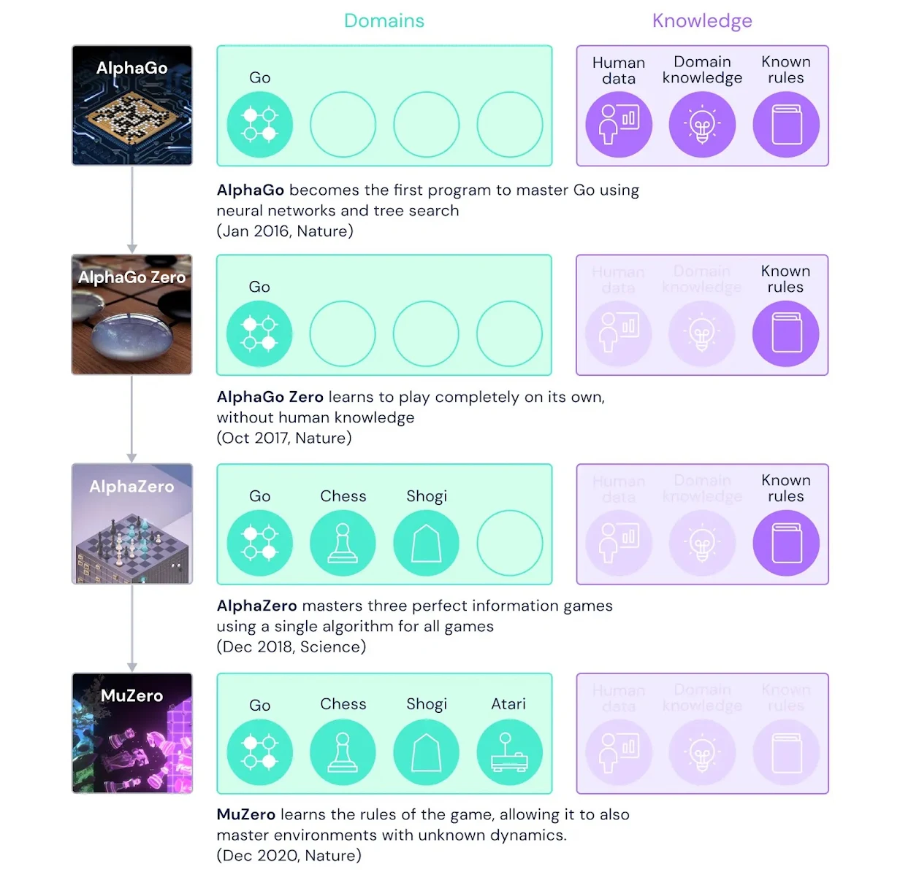](../../assets/images/AlphaGo2MuZero.png)

**Attribution**: [MuZero : Maîtriser le Go, les échecs, le shogi et Atari sans règles](https://deepmind.google/discover/blog/muzero-mastering-go-chess-shogi-and-atari-without-rules/), Google DeepMind, 23-12-2020. Schrittwieser et al. ([2020](#ref-Schrittwieser:2020aa))

[David Silver](https://www.davidsilver.uk) a dirigé les recherches de DeepMind à l’origine de ces projets et est professeur à l’University College London. Il a obtenu son doctorat à l’Université de l’Alberta sous la direction de [Richard Sutton](https://apps.ualberta.ca/directory/person/rsutton).

Vous pourriez également vouloir regarder la vidéo suivante : [AlphaGo Zero : Découvrir de nouvelles connaissances](https://youtu.be/WXHFqTvfFSw?si=oXsOtb2uxvU1CyKb). Publiée sur YouTube le 18-10-2017.

# Recherche

## Applications

- **Cheminement et navigation** : Utilisé en robotique et dans les jeux vidéo pour trouver un **chemin** d’un **point de départ** à une **destination**.

- **Résolution de puzzles** : Résolution de problèmes comme le **puzzle à 8 tuiles**, **labyrinthes**, ou **Sudoku**.

- **Analyse de réseaux** : Analyse de connectivité et des chemins les plus courts dans les **réseaux sociaux** ou les **cartes de transport**.

- **Jeux** : Évaluation des coups dans les jeux comme **les échecs** ou le **Go**, en particulier en combinaison avec d’autres stratégies.

## Applications

- **Ordonnancement** : Planification et ordonnancement des tâches dans la **fabrication**, la **gestion de projet** ou l’**ordonnancement de vols**.

- **Allocation de ressources** : Allocation de ressources dans un réseau ou une organisation où des **contraintes** doivent être satisfaites.

- **Problèmes de configuration** : Assemblage de composants pour satisfaire des exigences précises, comme la configuration d’un système informatique ou la **conception d’un circuit**.

## Applications

- **Prise de décision sous incertitude** : Évaluation de décisions dans des **jeux de stratégie en temps réel** et des **simulations**, dans des conditions incertaines.

- **Narration** : Les modèles de langage peuvent générer des récits lorsqu’ils sont guidés par un plan valide provenant d’un **planificateur automatisé**. ([Simon et Muise 2024](#ref-Simon:2024aa))

Les applications des algorithmes de recherche sont à la fois **nombreuses** et **diverses**.

La recherche a été un domaine actif d’investigation non seulement en raison de sa large gamme d’applications, mais aussi en raison du potentiel d’améliorations des algorithmes pour réduire significativement le temps d’exécution des programmes ou faciliter l’exploration de plus grands espaces de recherche.

## Plan

1.  **Recherche déterministe et heuristique** : BFS, DFS, A\* pour la recherche de chemins et l’optimisation en IA classique.

2.  **Algorithmes basés sur la population** : Accent sur les problèmes structurés et la recherche stochastique.

3.  **Algorithmes de jeux adversariaux** : Minimax, élagage alpha-bêta, MCTS pour la prise de décision dans des environnements compétitifs.

Ce cours et les suivants couvriront en détail ces sujets.

## Définition

> **NOTE:**
>
> Lorsqu’il n’est pas immédiatement évident de savoir quelle action correcte entreprendre, un agent peut avoir besoin de **planifier à l’avance** : considérer une **séquence d’actions** qui forment un **chemin** vers un **état objectif**. Un tel agent est appelé un **agent de résolution de problèmes**, et le processus computationnel qu’il entreprend est appelé **recherche**.

## Terminologie

[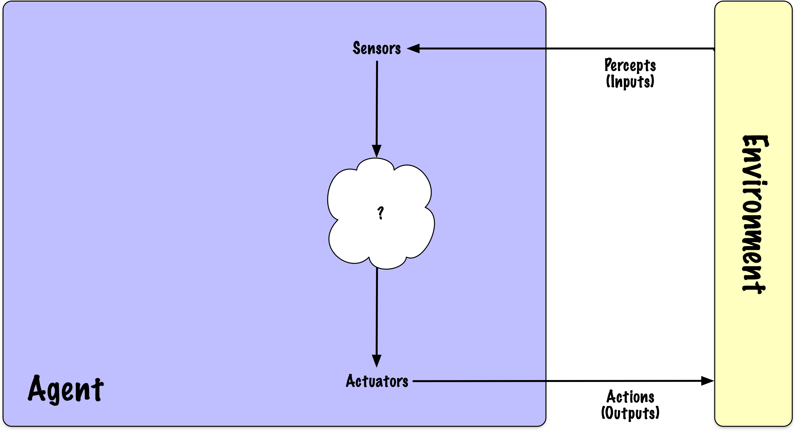](../../assets/images/agent-01.png)

Un **agent** est une entité qui effectue des **actions**. Un **agent rationnel** sélectionne les actions susceptibles d’obtenir le **meilleur résultat attendu**, compte tenu de ses informations et de sa mesure de performance. Conceptuellement, un **agent** perçoit son environnement par le biais de **capteurs** et interagit avec celui-ci à l’aide d’**actionneurs**.

La définition d’un agent en **intelligence artificielle (IA)** partage certaines similitudes avec la définition **psychologique**, mais il existe des distinctions clés. En IA, un agent est une **entité autonome** qui perçoit son **environnement** grâce à des **capteurs** et agit sur celui-ci à l’aide d’**actionneurs** pour atteindre des **objectifs spécifiques**. Les deux définitions impliquent la **perception**, la **prise de décision** et l’**action**.

Cependant, alors que les agents psychologiques sont humains ou biologiques et impliquent des processus **cognitifs** et **émotionnels complexes**, les agents en IA sont computationnels et fonctionnent sur la base d’algorithmes conçus pour **maximiser certaines mesures de performance** ou **atteindre des objectifs prédéfinis**. L’accent en IA est davantage mis sur la mise en œuvre technique de ces processus, tandis qu’en psychologie, l’accent est mis sur la compréhension des aspects cognitifs et motivationnels de l’agentivité.

Le concept de **conception agentique** en ingénierie logicielle et en intelligence artificielle a connu une résurgence de popularité.

## Caractéristiques de l’environnement

- **Observabilité** : Partiellement observable ou *totalement observable*

- **Composition de l’agent** : *Agent unique* ou multiple

- **Prédictibilité** : *Déterministe* ou non déterministe

- **Dépendance des décisions** : Épisodique ou *séquentielle*

- **Dynamique temporelle** : *Statique* ou dynamique

- **Représentation de l’état** : *Discrète* ou continue

Dans cette présentation, les environnements sont supposés être : *totalement observables*, à *agent unique*, *séquentiels*, *déterministes*, *statiques* et *discrets*.

Les caractéristiques d’un environnement influencent la complexité de la résolution de problèmes.

- Un **environnement totalement observable** permet à l’agent de détecter tous les aspects pertinents pour la prise de décision.

- Dans un **environnement déterministe**, l’agent peut prédire l’état suivant en fonction de l’état actuel et de son action subséquente.

- Les **environnements épisodiques** impliquent des décisions indépendantes : une action dans un épisode n’affecte pas les épisodes suivants. La classification d’images indépendantes en est un exemple.

- Les **environnements séquentiels** exigent de considérer l’effet d’une action sur les décisions futures. Le 8-Puzzle et les échecs en sont des exemples. Un état peut résumer tout l’historique pertinent sans rendre la tâche épisodique.

- Un **environnement dynamique** peut changer indépendamment pendant que l’agent délibère. Un **environnement statique** ne change pas pendant la délibération, mais les actions de l’agent peuvent tout de même en modifier l’état.

- Les échecs servent d’exemple d’environnement **discret**, avec des états et des actions distincts. Les espaces discrets peuvent être finis ou dénombrablement infinis. En revanche, un véhicule autonome fonctionne dans un environnement à **état continu** et **temps continu**.

## Processus de résolution de problèmes

**Recherche** : L’agent simule des séquences d’actions possibles dans un modèle pour trouver un chemin vers un état objectif. Une séquence réussie est une **solution**, que l’agent peut ensuite exécuter.

Une formulation précise facilite le développement de code réutilisable.

Sous ces hypothèses, une solution, lorsqu’elle existe, peut être exprimée comme une séquence fixe d’actions plutôt que comme une politique qui se ramifie selon des résultats incertains.

- **Séquentiel** : Chaque action modifie l’état et peut affecter les actions ultérieures qui mènent à l’objectif. La représentation de l’état conserve les informations nécessaires pour prédire les transitions futures.

- **Agent unique** : Il n’y a pas d’interaction avec d’autres agents qui pourrait introduire de la variabilité.

- **Totalement observable** : L’agent dispose d’informations complètes sur l’environnement, permettant une prise de décision précise.

- **Déterministe** : Le résultat des actions est prévisible, sans aléatoire affectant le résultat.

- **Statique** : L’environnement ne change pas indépendamment pendant que l’agent planifie ; l’exécution d’une action modifie tout de même l’état.

- **Discret** : Les états et les actions sont des possibilités distinctes pouvant être considérées séparément ; l’espace n’est pas nécessairement fini.

Cette formulation relie les algorithmes familiers de parcours de graphes à la planification : la recherche sélectionne une séquence dans le modèle avant que l’agent l’exécute dans l’environnement.

## Problème de recherche

- Un ensemble d’**états**, appelé **espace d’états**.

- Un **état initial** où l’agent commence.

- Un ou plusieurs **états objectifs** qui définissent des résultats réussis, reconnus par un **test d’objectif**.

- Un ensemble d’**actions** disponibles dans un état donné s.

- Un **modèle de transition** qui détermine l’état suivant en fonction de l’état actuel et de l’action sélectionnée.

- Une **fonction de coût d’action** qui spécifie le coût de l’exécution de l’action a dans l’état s pour atteindre l’état s'.

## Définitions

- Un **chemin** est une séquence d’états reliés par des actions ; il peut être représenté par la séquence d’actions ou par la séquence d’états qui en résulte.

- Une **solution** est un chemin qui relie l’état initial à l’état objectif.

- Une **solution optimale** est le chemin avec le coût le plus bas parmi toutes les solutions possibles.

Nous supposons que le **coût du chemin** est la somme des coûts individuels des actions, et que tous les coûts sont positifs. L’espace d’états peut être conceptualisé comme un **graphe**, où les nœuds représentent les états et les arêtes correspondent aux actions.

Dans certains problèmes, plusieurs solutions optimales peuvent exister. Cependant, il est généralement suffisant d’identifier et de rapporter une seule solution optimale. Fournir toutes les solutions optimales peut considérablement augmenter la complexité en temps et en espace pour certains problèmes.

## Exemple : 8-Puzzle

Code

``` python
import random
import matplotlib.pyplot as plt
import numpy as np

random.seed(58)

def is_solvable(tiles):
    # Compter les inversions dans la liste à plat des tuiles (en excluant l'espace vide)
    # Hypothèse : le plateau est carré et sa largeur est impaire.
    inversions = 0
    for i in range(len(tiles)):
        for j in range(i + 1, len(tiles)):
            if tiles[i] != 0 and tiles[j] != 0 and tiles[i] > tiles[j]:
                inversions += 1
    return inversions % 2 == 0

def generate_solvable_board():
    # Générer une configuration de plateau aléatoire qui est garantie d'être résoluble
    tiles = list(range(9))
    random.shuffle(tiles)
    while not is_solvable(tiles):
        random.shuffle(tiles)

    return tiles

def plot_board(board, title, num_pos, position):
    ax = plt.subplot(1, num_pos, position)
    ax.set_title(title)
    ax.set_xticks([])
    ax.set_yticks([])

    board = np.array(board).reshape(3, 3).tolist() # Reconfigurer en une grille 3x3

    # Utiliser une carte de couleurs pour afficher les numéros
    cmap = plt.cm.plasma
    norm = plt.Normalize(vmin=-1, vmax=8)

    for i in range(3):
        for j in range(3):
            tile_value = board[i][j]
            color = cmap(norm(tile_value))
            ax.add_patch(plt.Rectangle((j, 2 - i), 1, 1, facecolor=color, edgecolor='black'))
            if tile_value == 0:
                ax.add_patch(plt.Rectangle((j, 2 - i), 1, 1, facecolor='white', edgecolor='black'))
            else:
                ax.text(j + 0.5, 2 - i + 0.5, str(tile_value),
                        fontsize=16, ha='center', va='center', color='black')

    ax.set_xlim(0, 3)
    ax.set_ylim(0, 3)
```

## Exemple : 8-Puzzle

Code

``` python
# Générer un plateau initial résoluble
initial_board = generate_solvable_board()

# Définir l'état objectif
goal_board = [
    [1, 2, 3],
    [4, 5, 6],
    [7, 8, 0]
]

# Tracer les deux plateaux
plt.figure(figsize=(8, 4))
plot_board(initial_board, "Plateau Initial", 2, 1)
plot_board(goal_board, "État Objectif", 2, 2)
plt.tight_layout()
plt.show()
```

[](slides_files/figure-html/cell-3-output-1.png)

## 8-Puzzle

- Comment les **états** peuvent-ils être représentés ?

- Qu’est-ce qui constitue l’**état initial** ?

- Qu’est-ce qui définit les **actions** ?

- Qu’est-ce qui constituerait un **chemin** ?

- Qu’est-ce qui caractérise l’**état objectif** ?

- Qu’est-ce qui constituerait une **solution** ?

- Quel devrait être le **coût d’une action** ?

Code

``` python
plt.figure(figsize=(2, 2))
plot_board(initial_board, "Plateau Initial", 1, 1)
plt.tight_layout()
plt.show()
```

[](slides_files/figure-html/cell-4-output-1.png)

- Chaque état peut être représenté comme une liste contenant les chiffres de 0 à 8. Chaque chiffre correspond à une tuile, et sa position dans la liste reflète sa localisation dans la grille, avec 0 désignant l’espace vide.

- L’état initial est une permutation des chiffres de 0 à 8.

- Les actions déplacent la **case vide** vers la **gauche**, la **droite**, le **haut** ou le **bas** en l’échangeant avec une tuile adjacente. Ces directions décrivent le déplacement de la case vide, pas celui de la tuile numérotée.

- Un chemin serait une séquence d’actions, par exemple **gauche**, **gauche**, **haut**.

- Le modèle de transition associe un état donné et une action à un nouvel état. Toutes les actions ne sont pas réalisables à partir de chaque état ; par exemple, si l’espace vide est au bord de la grille, seules certaines actions sont possibles, comme bas, haut ou gauche.

- L’état objectif est atteint lorsque la liste est ordonnée de 1 à 8, suivi de 0, indiquant que les tuiles sont correctement disposées. Combien y a-t-il d’états objectifs ? Cette formulation précise un seul état objectif, bien qu’un autre problème puisse en permettre plusieurs.

- Une solution serait un chemin valide transformant un état initial en un état objectif.

- Chaque action entraîne un coût de 1.

Combien d’états possibles y a-t-il ?

Il y a 9! = 362\\880 arrangements des huit tuiles et de la case vide. Seule la moitié, 9!/2 = 181\\440, est accessible depuis un état initial fixé. La recherche exhaustive sur graphe est envisageable à cette échelle.

Combien y a-t-il d’états pour le 15-Puzzle ?

Il y a 16! = 20\\922\\789\\888\\000 arrangements des quinze tuiles et de la case vide, dont 16!/2 = 10\\461\\394\\944\\000 sont accessibles depuis un état initial fixé : environ 10 461 milliards. Cet espace beaucoup plus grand motive une recherche plus sélective. Voir [le dénombrement des états du 15-Puzzle](https://kociemba.org/themen/fifteen/fifteensolver.html).

## Résolvables ?

Code

``` python
some_board = [
    [1, 2, 3],
    [4, 5, 6],
    [8, 7, 0]
]

plt.figure(figsize=(2, 2))
plot_board(some_board, "", 1, 1)
plt.tight_layout()
plt.show()
```

[](slides_files/figure-html/cell-5-output-1.png)

## Résolvables ?

- Un tableau du **8-Puzzle** est résolvable s’il a la même **parité d’inversion** que l’état objectif.

- Une **inversion** est une paire de tuiles (à l’exclusion du vide) qui sont dans le mauvais ordre l’une par rapport à l’autre, lorsqu’on lit le tableau comme une liste unidimensionnelle (de gauche à droite, de haut en bas).

- Lorsque le but est la séquence ordonnée de 1 à 8, il n’y a pas d’inversion, et donc la parité est paire.

- Voir Archer ([1999](#ref-Archer:1999aa)) ou [Slider Puzzle, Princeton](https://www.cs.princeton.edu/courses/archive/spring21/cos226/assignments/8puzzle/specification.php)

Pour un plateau de largeur impaire comme le puzzle 3×3, deux arrangements sont reliés par des déplacements permis exactement lorsque leurs parités d’inversion concordent. Cette règle fondée uniquement sur les inversions ne s’étend pas aux plateaux de largeur paire : pour le puzzle 4×4, le test de résolubilité doit aussi tenir compte de la rangée de la case vide.

## `count_even_odd_parity`

Code

``` python
from itertools import permutations

def count_even_odd_parity():
    even_count = 0
    odd_count = 0

    for perm in permutations(range(9)):  # 0 représente la tuile vide
        inversions = 0
        for i in range(9):
            for j in range(i + 1, 9):
                if perm[i] != 0 and perm[j] != 0 and perm[i] > perm[j]:
                    inversions += 1
        if inversions % 2 == 0:
            even_count += 1
        else:
            odd_count += 1

    return even_count, odd_count
```

``` python
even, odd = count_even_odd_parity()

print(f"Parité paire : {even}")
print(f"Parité impaire : {odd}")
```

    Parité paire : 181440
    Parité impaire : 181440

## Arbre de recherche

[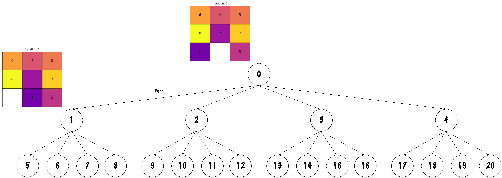](../../assets/images/search_tree-00.png)

Un **arbre de recherche** représente des **chemins** possibles depuis l’**état initial**. Chaque **nœud** représente un état atteint par un chemin particulier, et chaque **arête** représente une action. Différents nœuds peuvent représenter le même état.

Les algorithmes construisent des nœuds représentant des états atteints par des chemins particuliers. Un nœud peut conserver son parent, l’action utilisée pour l’atteindre et le coût du chemin. Dans les implémentations ci-dessous, une paire `(state, path)` conserve l’état et la séquence des états précédents.

Le **graphe de l’espace d’états** décrit le problème : ses sommets sont des états et ses arêtes sont des actions. L’**arbre de recherche** décrit les chemins considérés pendant la recherche. Plusieurs chemins peuvent atteindre le même état, qui peut donc apparaître à plusieurs nœuds de l’arbre. Les algorithmes ci-dessous détectent les états répétés : ce sont des implémentations de **recherche sur graphe**, qui ne conservent pas chaque occurrence répétée de l’arbre conceptuel.

## Arbre de recherche

[](../../assets/images/search_bfs-00.png)

Un exemple d’**arbre de recherche** pour le **8-Puzzle**. La solution ici est incomplète.

## Arbre de recherche

- La **racine** de l’arbre de recherche représente l’**état initial** du problème.

- **Développer** un nœud génère les états successeurs en appliquant les **actions disponibles** à son état.

- Le **résultat** d’une action est le nouvel état atteint après avoir **appliqué cette action** à l’**état actuel**.

- Chaque nœud sauf la **racine** a un **parent**, y compris les nœuds **feuilles**. Le développement d’un nœud peut générer des **enfants**.

Une caractéristique distinctive d’un algorithme de recherche est sa méthode pour **sélectionner le prochain nœud à développer**.

## Frontière

[](../../assets/images/search_bfs-01.png)

Tout état correspondant à un nœud dans l’arbre de recherche est considéré comme **atteint**. Les nœuds de la **frontière** sont ceux qui ont été **atteints** mais n’ont **pas encore été développés**. Ci-dessus, il y a **10 nœuds développés** et **11 nœuds de frontière**, ce qui donne un total de 21 nœuds qui ont été **atteints**.

## Frontière

[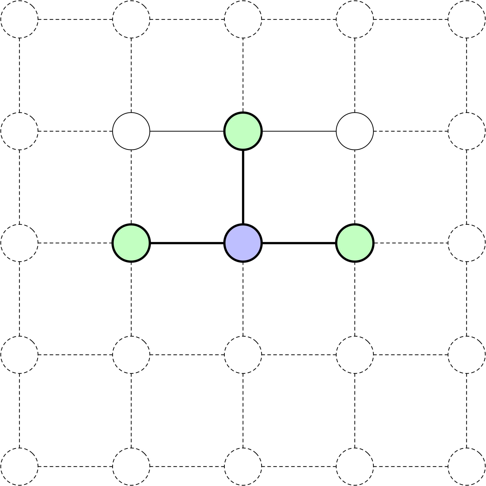](../../assets/images/search_frontier-01.png)

[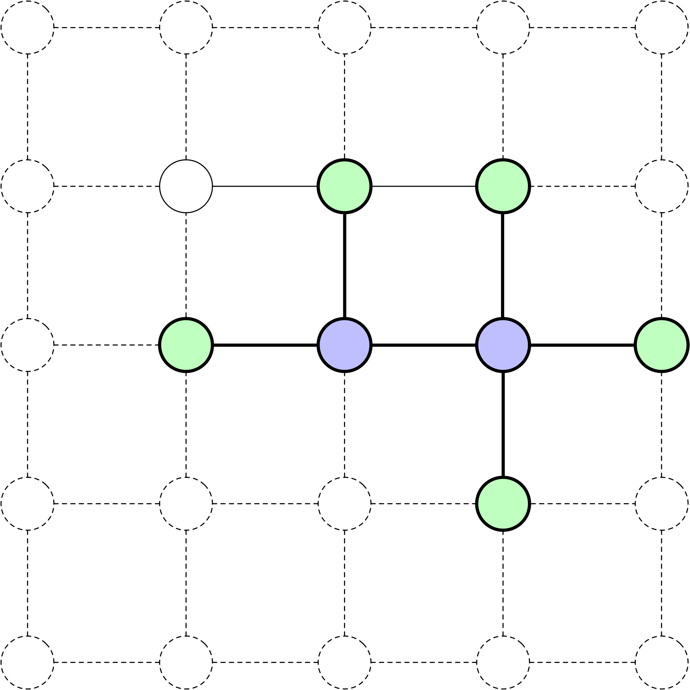](../../assets/images/search_frontier-02.png)

[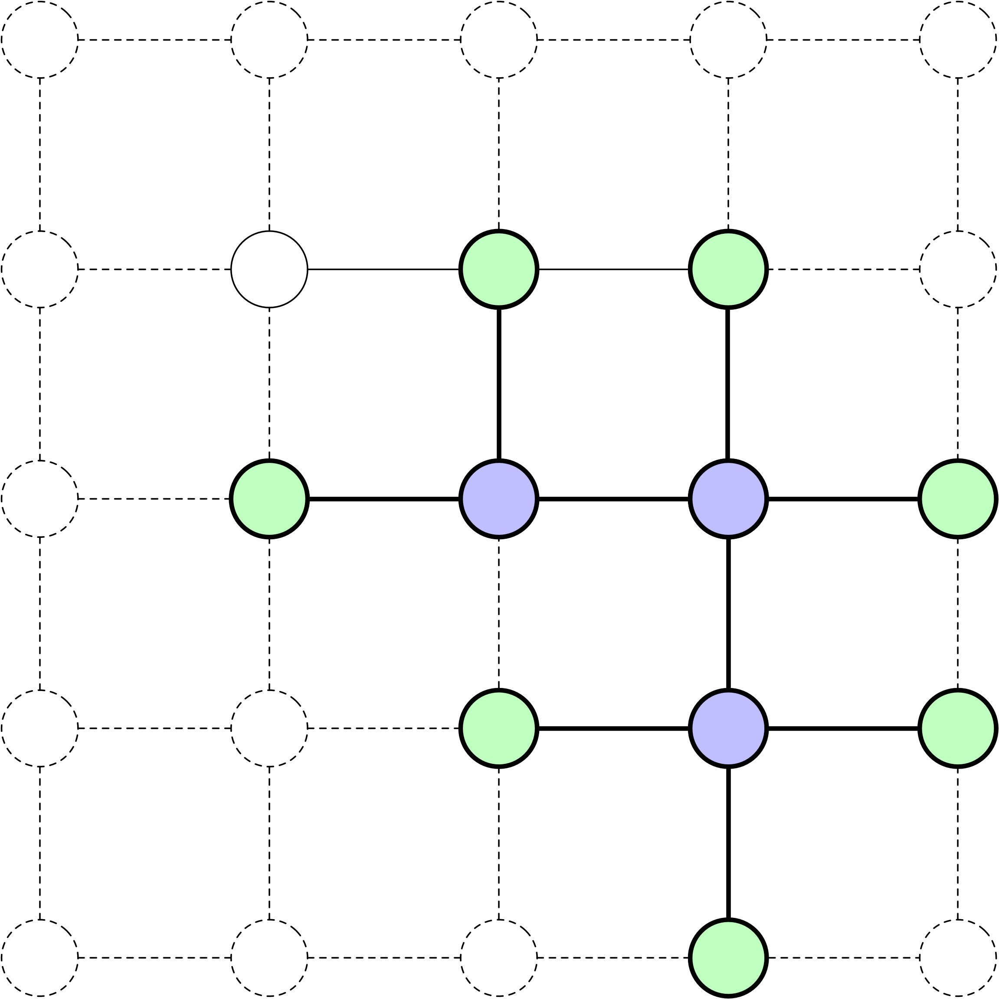](../../assets/images/search_frontier-03.png)

Dans le 8-Puzzle, la case vide peut se déplacer vers la **gauche**, la **droite**, le **haut** ou le **bas** lorsque les limites du plateau le permettent. Les diagrammes représentent schématiquement la frontière de recherche : les **nœuds violets** sont développés ; les **nœuds verts** sont atteints mais non développés. Ils ne représentent pas le plateau physique du puzzle.

Ces graphes schématiques illustrent l’évolution d’une frontière lorsque des nœuds sont développés. Développer un nœud vert génère ses successeurs : les états nouvellement atteints entrent dans la frontière, tandis que les états déjà atteints ne sont pas ajoutés à nouveau dans les implémentations de recherche sur graphe ci-dessous. Les nœuds violets ont déjà été développés. Les positions dessinées sur la grille ne représentent pas les tuiles du 8-Puzzle et ne déterminent pas les déplacements permis dans le puzzle.

## Frontière

[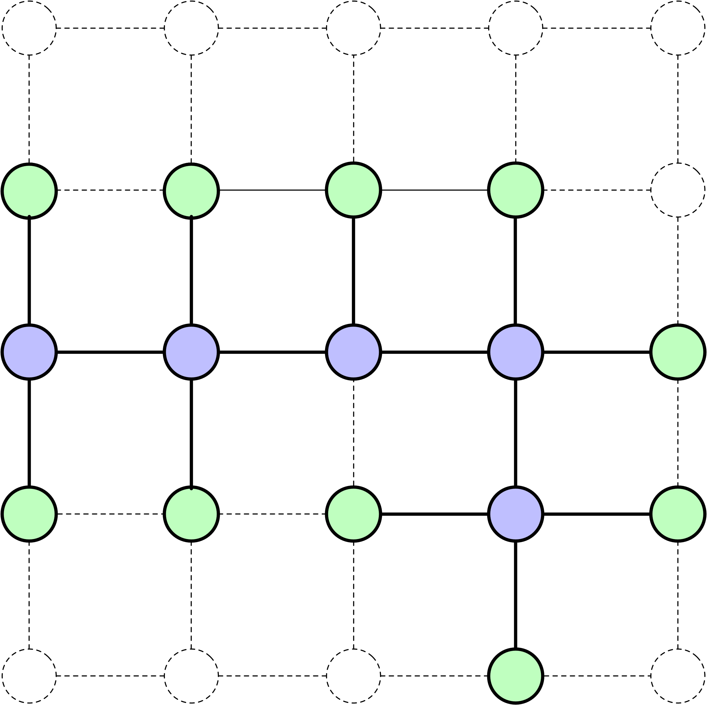](../../assets/images/search_frontier-04.png)

[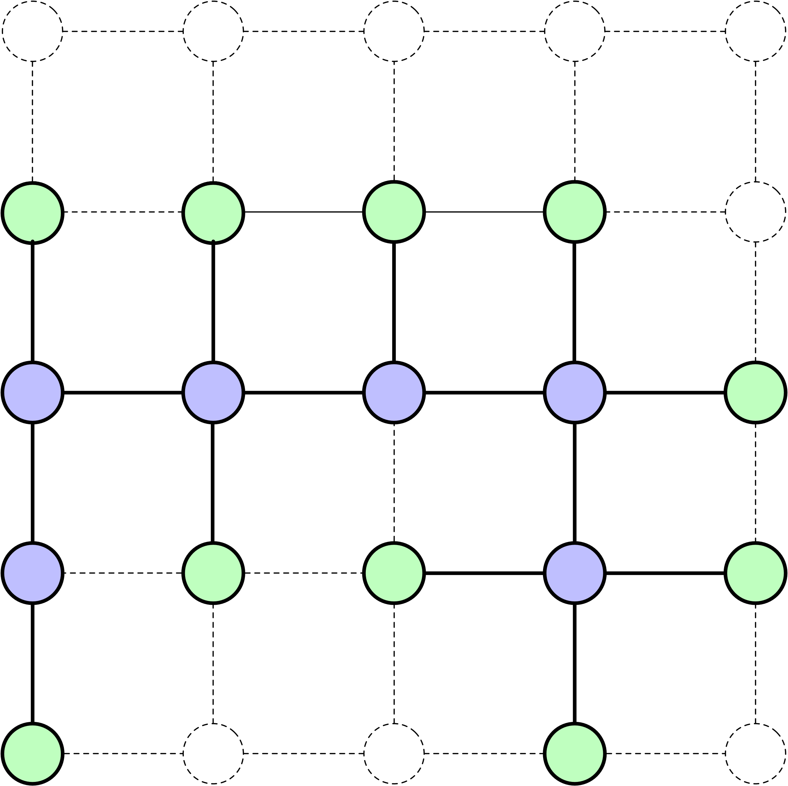](../../assets/images/search_frontier-05.png)

# Recherche non informée

## Définition

Une **recherche non informée** (ou recherche aveugle) utilise les informations de la définition du problème sans **estimation heuristique supplémentaire du coût restant jusqu’à un objectif**. Les actions, les règles de transition, les tests d’objectif et les coûts d’action propres au problème restent disponibles.

## Représentation de l’état

Code

``` python
# Tracer les deux plateaux
initial_state_8 = [6, 4, 5,
                   8, 2, 7,
                   1, 0, 3]

goal_state_8 = [1, 2, 3,
                4, 5, 6,
                7, 8, 0]

plt.figure(figsize=(4, 2))
plot_board(initial_state_8, "Plateau Initial", 2, 1)
plot_board(goal_state_8, "État Objectif", 2, 2)
plt.tight_layout()
plt.show()
```

[](slides_files/figure-html/cell-8-output-1.png)

``` python
initial_state_8 = [6, 4, 5,
                   8, 2, 7,
                   1, 0, 3]

goal_state_8 = [1, 2, 3,
                4, 5, 6,
                7, 8, 0]
```

Les états sont représentés comme des **listes** de chiffres. `0` représente la **tuile vide**.

## `is_goal`

``` python
def is_goal(state, goal_state):
    """Détermine si un état donné correspond à l'état objectif."""
    return state == goal_state
```

Fonction auxiliaire qui implémente le test d’objectif.

## `expand`

``` python
def expand(state):
    """Génère les états successeurs en déplaçant la tuile vide dans toutes les directions possibles."""
    size = int(len(state) ** 0.5) # Déterminer la taille du puzzle (3 pour le 8-Puzzle, 4 pour le 15-Puzzle)
    idx = state.index(0) # Trouver l'index de la tuile vide représentée par 0
    x, y = idx % size, idx // size # Convertir l'index en coordonnées (x, y)
    neighbors = []

    # Définir les mouvements possibles : Gauche, Droite, Haut, Bas
    moves = [(-1, 0), (1, 0), (0, -1), (0, 1)]
    for dx, dy in moves:
        nx, ny = x + dx, y + dy
        # Vérifier si la nouvelle position est dans les limites du puzzle
        if 0 <= nx < size and 0 <= ny < size:
            n_idx = ny * size + nx
            new_state = state.copy()
            # Échanger la tuile vide avec la tuile adjacente
            new_state[idx], new_state[n_idx] = new_state[n_idx], new_state[idx]
            neighbors.append(new_state)
    return neighbors
```

## `expand`

Code

``` python
plt.figure(figsize=(8, 2))

successors = expand(initial_state_8)

plot_board(initial_state_8, "État Initial", 4, 1)

for i, successor in enumerate(successors):
    plot_board(successor, f"Successeur : {i}", 4, i+2)

plt.tight_layout()
plt.show()
```

[](slides_files/figure-html/cell-12-output-1.png)

``` python
expand(initial_state_8)
```

    [[6, 4, 5, 8, 2, 7, 0, 1, 3],
     [6, 4, 5, 8, 2, 7, 1, 3, 0],
     [6, 4, 5, 8, 0, 7, 1, 2, 3]]

## `is_empty`

``` python
def is_empty(frontier):
    """Vérifie si la frontière est vide."""
    return len(frontier) == 0
```

Si la frontière devient vide (plus de nœuds à développer), le problème n’a pas de solution.

Existe-t-il des plateaux de 8-Puzzle qui n’ont pas de solutions ?

La résolubilité du 8-Puzzle dépend du nombre d’**inversions** dans l’état initial. Une inversion est une paire de tuiles où une tuile avec un numéro plus élevé précède une tuile avec un numéro plus bas lorsque le puzzle est vu comme une séquence (en excluant la tuile vide).

Si la parité du nombre d’inversions de l’état initial et de l’état objectif ne sont pas les mêmes, alors il n’y a pas de solutions.

## `print_solution`

``` python
def print_solution(solution):
    """Affiche la séquence d'étapes de l'état initial à l'état objectif."""
    size = int(len(solution[0]) ** 0.5)
    for step, state in enumerate(solution):
        print(f"Étape {step} :")
        for i in range(size):
            row = state[i*size:(i+1)*size]
            print(' '.join(str(n) if n != 0 else ' ' for n in row))
        print()
```

## Cycles

. . .

Un chemin qui revisite les mêmes états forme un **cycle**.

Permettre des cycles rendrait l’**arbre de recherche** résultant **infini**.

Pour éviter cela, nous surveillons les états qui ont été atteints, bien que cela entraîne un **coût en mémoire**.

# Recherche en largeur

## Recherche en largeur

``` python
from collections import deque
```

La **recherche en largeur (BFS)** utilise une **file d’attente** pour gérer les nœuds de la frontière, également connus sous le nom de liste ouverte.

## Recherche en largeur

``` python
def bfs(initial_state, goal_state):
    frontier = deque() # Initialiser la file d'attente pour BFS
    frontier.append((initial_state, [])) # Un nœud : (état, états précédents)

    reached = set()
    reached.add(tuple(initial_state))

    expanded = 0 # Nombre de nœuds non objectifs dont les successeurs sont générés

    while not is_empty(frontier):
        current_state, path = frontier.popleft()

        if is_goal(current_state, goal_state):
            print(f"Nœuds développés : {expanded}")
            return path + [current_state] # Retourner le chemin réussi

        expanded += 1

        for neighbor in expand(current_state):
            neighbor_tuple = tuple(neighbor)
            if neighbor_tuple not in reached:
                reached.add(neighbor_tuple)
                frontier.append((neighbor, path + [current_state]))

    return None # Aucune solution trouvée
```

Trouver un chemin comportant le **moins d’actions**. C’est une **solution de coût minimal lorsque les coûts d’action sont égaux**, comme dans le 8-Puzzle.

BFS sélectionne les nœuds par profondeur non décroissante, car la frontière est une file d’attente « premier entré, premier sorti ». Lorsque les coûts d’action sont égaux, le premier chemin qui atteint un état est un chemin de coût minimal vers cet état ; les occurrences ultérieures peuvent donc être écartées. Des coûts d’action différents rompent l’équivalence entre le moins d’actions et le coût minimal.

L’ensemble `reached` contient les états de la frontière ainsi que les états développés. Le compteur `expanded` augmente uniquement lorsque les successeurs d’un nœud non objectif sont générés ; la sélection d’un objectif ne l’augmente pas. La solution retournée est une séquence d’états incluant les deux extrémités ; son nombre de déplacements est donc `len(solution) - 1`.

## Cas simple

Code

``` python
plt.figure(figsize=(8, 2))

initial_state_8 = [1, 2, 3,
                   4, 0, 6,
                   7, 5, 8]

goal_state_8 = [1, 2, 3,
                4, 5, 6,
                7, 8, 0]

solutions = bfs(initial_state_8, goal_state_8)

for i, solution in enumerate(solutions):
    plot_board(solution, f"Étape : {i}", 3, i+1)

plt.tight_layout()
plt.show()
```

    Nœuds développés : 12

[](slides_files/figure-html/cell-18-output-2.png)

``` python
initial_state_8 = [1, 2, 3,
                   4, 0, 6,
                   7, 5, 8]

goal_state_8 = [1, 2, 3,
                4, 5, 6,
                7, 8, 0]

bfs(initial_state_8, goal_state_8)
```

    Nœuds développés : 12

    [[1, 2, 3, 4, 0, 6, 7, 5, 8],
     [1, 2, 3, 4, 5, 6, 7, 0, 8],
     [1, 2, 3, 4, 5, 6, 7, 8, 0]]

## Cas difficile

``` python
initial_state_8 = [6, 4, 5,
                   8, 2, 7,
                   1, 0, 3]

goal_state_8 = [1, 2, 3,
                4, 5, 6,
                7, 8, 0]

print("Résolution du 8-Puzzle avec la recherche en largeur (BFS)...")

solution_8_bfs = bfs(initial_state_8, goal_state_8)

if solution_8_bfs:
    print(f"Solution BFS trouvée en {len(solution_8_bfs) - 1} mouvements :")
    print_solution(solution_8_bfs)
else:
    print("Aucune solution trouvée pour le 8-Puzzle en utilisant BFS.")
```

    Résolution du 8-Puzzle avec la recherche en largeur (BFS)...
    Nœuds développés : 145605
    Solution BFS trouvée en 25 mouvements :
    Étape 0 :
    6 4 5
    8 2 7
    1   3

    Étape 1 :
    6 4 5
    8 2 7
      1 3

    Étape 2 :
    6 4 5
      2 7
    8 1 3

    Étape 3 :
    6 4 5
    2   7
    8 1 3

    Étape 4 :
    6   5
    2 4 7
    8 1 3

    Étape 5 :
      6 5
    2 4 7
    8 1 3

    Étape 6 :
    2 6 5
      4 7
    8 1 3

    Étape 7 :
    2 6 5
    4   7
    8 1 3

    Étape 8 :
    2 6 5
    4 1 7
    8   3

    Étape 9 :
    2 6 5
    4 1 7
      8 3

    Étape 10 :
    2 6 5
      1 7
    4 8 3

    Étape 11 :
    2 6 5
    1   7
    4 8 3

    Étape 12 :
    2 6 5
    1 7  
    4 8 3

    Étape 13 :
    2 6 5
    1 7 3
    4 8  

    Étape 14 :
    2 6 5
    1 7 3
    4   8

    Étape 15 :
    2 6 5
    1   3
    4 7 8

    Étape 16 :
    2   5
    1 6 3
    4 7 8

    Étape 17 :
    2 5  
    1 6 3
    4 7 8

    Étape 18 :
    2 5 3
    1 6  
    4 7 8

    Étape 19 :
    2 5 3
    1   6
    4 7 8

    Étape 20 :
    2   3
    1 5 6
    4 7 8

    Étape 21 :
      2 3
    1 5 6
    4 7 8

    Étape 22 :
    1 2 3
      5 6
    4 7 8

    Étape 23 :
    1 2 3
    4 5 6
      7 8

    Étape 24 :
    1 2 3
    4 5 6
    7   8

    Étape 25 :
    1 2 3
    4 5 6
    7 8  

## Arbre de recherche BFS

[](../../assets/images/search_bfs-00.png)

L’arbre de recherche ci-dessus illustre les 20 premiers développements de nœuds de la recherche en largeur (BFS) pour l’état initial spécifié.

# Recherche en profondeur

## Recherche en profondeur

``` python
def dfs(initial_state, goal_state):
    frontier = [(initial_state, [])] # Un nœud : (état, états précédents)

    reached = set()
    reached.add(tuple(initial_state))

    expanded = 0

    while not is_empty(frontier):
        current_state, path = frontier.pop()

        if is_goal(current_state, goal_state):
            print(f"Nœuds développés : {expanded}")
            return path + [current_state] # Retourner le chemin réussi

        expanded += 1

        for neighbor in expand(current_state):
            neighbor_tuple = tuple(neighbor)
            if neighbor_tuple not in reached:
                reached.add(neighbor_tuple)
                frontier.append((neighbor, path + [current_state]))

    return None # Aucune solution trouvée
```

Quel est le comportement de la **recherche en profondeur (DFS)** ?

La **recherche en profondeur (DFS)** utilise une **pile**, selon le principe « dernier entré, premier sorti ». Les nouveaux nœuds sont sélectionnés avant les autres possibilités plus anciennes ; la recherche suit donc une branche en profondeur avant de revenir aux autres nœuds de la frontière. L’ordre des successeurs compte : comme `expand` les énumère dans l’ordre gauche, droite, haut, bas et que la pile retire sa dernière entrée, DFS essaie d’abord le dernier successeur ajouté.

Quand le processus d’approfondissement s’arrête-t-il ?

Il cesse de suivre une branche lorsqu’un objectif est trouvé ou qu’aucun nouveau successeur ne peut être ajouté : aucune action n’est disponible ou tous les successeurs ont déjà été atteints.

Que se passe-t-il ensuite ?

L’algorithme retire le dernier nœud ajouté qui reste dans la frontière. Le chemin conservé indique comment cette autre possibilité a été atteinte ; le code n’annule pas des déplacements sur un plateau partagé.

Si ce nœud n’a pas non plus de nouveaux successeurs, l’algorithme passe à l’entrée suivante de la pile. La détection des états répétés empêche les cycles d’ajouter continuellement les mêmes états.

## Arbre de recherche DFS

[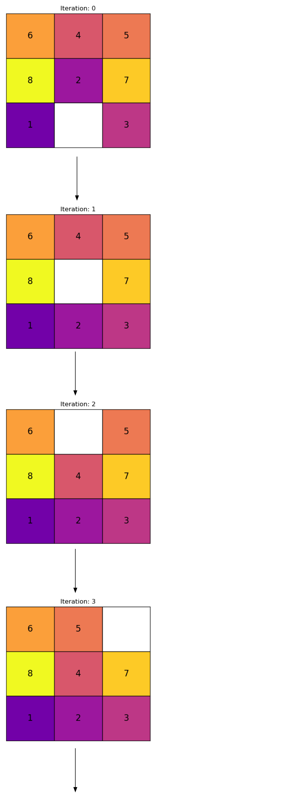](../../assets/images/search_dfs-01.png)

## Arbre de recherche DFS

[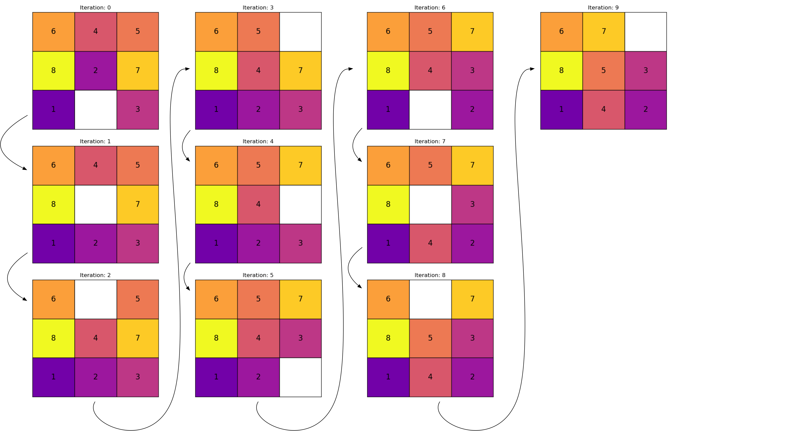](../../assets/images/search_dfs-00.png)

## Cas Simple

Code

``` python
plt.figure(figsize=(8, 2))

initial_state_8 = [1, 2, 3,
                   4, 0, 6,
                   7, 5, 8]

goal_state_8 = [1, 2, 3,
                4, 5, 6,
                7, 8, 0]

solutions = dfs(initial_state_8, goal_state_8)

for i, solution in enumerate(solutions):
    plot_board(solution, f"Étape : {i}", 3, i+1)

plt.tight_layout()
plt.show()
```

    Nœuds développés : 2

[](slides_files/figure-html/cell-22-output-2.png)

``` python
initial_state_8 = [1, 2, 3,
                   4, 0, 6,
                   7, 5, 8]

goal_state_8 = [1, 2, 3,
                4, 5, 6,
                7, 8, 0]

dfs(initial_state_8, goal_state_8)
```

    Nœuds développés : 2

    [[1, 2, 3, 4, 0, 6, 7, 5, 8],
     [1, 2, 3, 4, 5, 6, 7, 0, 8],
     [1, 2, 3, 4, 5, 6, 7, 8, 0]]

## Cas Difficile

``` python
initial_state_8 = [6, 4, 5,
                   8, 2, 7,
                   1, 0, 3]

goal_state_8 = [1, 2, 3,
                4, 5, 6,
                7, 8, 0]

print("Résolution du 8-Puzzle avec DFS...")

solution_8_dfs = dfs(initial_state_8, goal_state_8)

if solution_8_dfs:
    print(f"Solution DFS trouvée en {len(solution_8_dfs) - 1} mouvements :")
    # print_solution(solution_8_dfs)
else:
    print("Aucune solution trouvée pour le 8-Puzzle en utilisant DFS.")
```

    Résolution du 8-Puzzle avec DFS...
    Nœuds développés : 1187
    Solution DFS trouvée en 1157 mouvements :

## Remarques

- **BFS :** 25 déplacements (optimal) ; 145 605 nœuds non objectifs développés.

- **DFS :** 1 157 déplacements ; 1 187 nœuds non objectifs développés.

| Propriété | BFS | DFS |
|----|----|----|
| Frontière | File FIFO | Pile LIFO |
| Complète sur un graphe accessible fini | Oui | Oui |
| Moins d’actions / coût minimal (coûts d’action égaux) | Garanti | Non garanti |
| Mémoire conservée | Frontière, états atteints, chemins copiés | Frontière, états atteints, chemins copiés |

Comment découvrir des solutions **plus efficacement** ?

La **recherche en profondeur (DFS)** produira-t-elle toujours des solutions sous-optimales ?

Non. DFS peut retourner une solution optimale si elle en rencontre une en premier, mais elle ne garantit pas que la première solution comporte le moins d’actions ou le coût le plus bas.

Est-il possible que DFS découvre des solutions supérieures à la solution optimale ?

Certainement pas ; de telles solutions seraient soit invalides (impliquant des mouvements impossibles), soit indiqueraient une erreur dans votre estimation.

Cela signifie-t-il que la recherche en profondeur (DFS) n’a pas d’applications pratiques ?

Quand est-il approprié d’utiliser DFS ?

La recherche en largeur (BFS) étend sa frontière systématiquement dans toutes les directions, ce qui entraîne une croissance rapide des besoins en mémoire.

DFS a souvent une frontière plus petite parce qu’elle suit une branche avant d’essayer d’autres possibilités. Cependant, le code présenté conserve tous les états atteints et copie les chemins dans les entrées de la frontière. Sa mémoire totale n’est donc pas limitée à la branche active, et une petite frontière ne suffit pas à établir une faible utilisation totale de mémoire.

La description habituelle de DFS comme méthode peu gourmande en mémoire s’applique aux implémentations qui conservent le chemin actif et les autres possibilités en attente, sans garder un registre global de tous les états atteints. Ces implémentations avec retour en arrière peuvent être utiles pour explorer systématiquement des solutions possibles. Leurs propriétés de gestion des répétitions et de terminaison diffèrent de celles du code de recherche sur graphe ci-dessus.

Le langage Prolog utilise un retour en arrière en profondeur pour chercher des réponses. Il peut énumérer des réponses, mais une branche infinie peut l’empêcher d’en atteindre d’autres.

La **complétude** signifie trouver une solution lorsqu’il en existe une. Les deux implémentations de recherche sur graphe présentées sont complètes sur un espace d’états accessibles fini, car chaque état est ajouté au plus une fois. BFS trouve aussi une solution de profondeur finie dans un espace infini à branchement fini ; DFS peut plutôt suivre indéfiniment une branche infinie.

Ces résultats numériques concernent le plateau initial et l’ordre des successeurs précisés. Les nombres de développements décrivent l’effort de recherche, pas le temps écoulé ni la mémoire maximale ; d’autres plateaux ou ordres de déplacement peuvent modifier considérablement la comparaison.

La recherche limitée en profondeur et la recherche en approfondissement itératif seraient des algorithmes de recherche non informée alternatifs.

Les fonctions heuristiques utilisent des connaissances supplémentaires pour estimer le coût restant jusqu’à un objectif et guider la recherche. Elles sont le sujet de la prochaine présentation.

# Épilogue

## Résumé

- Justification pour l’étude de la recherche
- Terminologie et concepts clés
- Algorithmes de recherche non informée
  - Recherche en largeur (BFS)
  - Recherche en profondeur (DFS)
- Implémentations : complétude, optimalité en coût et mémoire

- **Justification pour l’étude de la recherche :**
  - Mise en avant de la transition de la focalisation exclusive sur l’apprentissage automatique à l’intégration des algorithmes de recherche.
  - Souligné le rôle de la recherche dans les systèmes d’IA avancés comme AlphaGo, AlphaZero et MuZero.
  - Noté que les algorithmes de recherche sont cruciaux pour la planification, le raisonnement, et seront de plus en plus importants.
- **Chronologie historique des algorithmes de recherche :**
  - Les jalons choisis vont de l’algorithme A\* en 1968 à FunSearch en 2023 et AlphaGeometry en 2024.
  - L’historique inclut des méthodes de recherche explicite, des avancées en apprentissage par renforcement et des systèmes combinant apprentissage et recherche.
- **Applications de la recherche :**
  - **Recherche de chemin et navigation :** Trouver des chemins optimaux en robotique et dans les jeux.
  - **Résolution de puzzles :** Résoudre des problèmes comme le 8-Puzzle et le Sudoku.
  - **Analyse de réseau :** Analyser la connectivité et les chemins les plus courts dans les réseaux.
  - **Jeu :** Évaluer des mouvements dans des jeux comme les échecs ou le Go.
  - **Planification et allocation des ressources :** Planifier des tâches et allouer efficacement des ressources.
  - **Problèmes de configuration :** Assembler des composants pour répondre à des exigences spécifiques.
  - **Prise de décision sous incertitude :** Prendre des décisions dans des environnements dynamiques et incertains.
  - **Narration :** Guider les modèles de langage avec des plans de planificateurs automatisés.
- **Terminologie et concepts clés :**
  - **Agent :** Une entité qui effectue des actions pour atteindre des objectifs.
  - **Caractéristiques de l’environnement :** Environnements entièrement observables, mono-agents, séquentiels, déterministes, statiques et discrets.
  - **Définition du problème de recherche :**
    - **Espace d’états :** Tous les états possibles.
    - **État initial :** Où l’agent commence.
    - **État(s) objectif(s) :** Résultat(s) souhaité(s).
    - **Actions :** Déplacements possibles depuis un état.
    - **Modèle de transition :** Règles déterminant les changements d’état.
    - **Fonction de coût d’action :** Coût associé aux actions.
- **Algorithmes de recherche non informée :**
  - **Recherche en largeur (BFS) :**
    - Explore l’espace de recherche niveau par niveau.
    - Garantit le moins d’actions, ainsi que le coût minimal lorsque les coûts d’action sont égaux, mais peut être gourmande en mémoire.
    - Implémenté en utilisant une file d’attente.
  - **Recherche en profondeur (DFS) :**
    - Explore aussi profondément que possible le long de chaque branche avant de revenir en arrière.
    - Ne garantit ni le moins d’actions ni le coût minimal. Une frontière plus petite ne supprime pas le coût en mémoire de l’ensemble global des états atteints et des copies de chemins dans cette implémentation.
    - Implémenté en utilisant une pile.
- **Implémentation de la recherche non informée :**
  - Utilisé le **8-Puzzle** comme problème d’exemple.
  - Représenté les états comme des listes de chiffres, avec `0` comme tuile vide.
  - Démontré les implémentations de BFS et DFS en Python.
  - Pour le plateau et l’ordre des déplacements précisés, BFS a trouvé la solution optimale après davantage de développements, tandis que DFS a trouvé une solution plus longue après moins de développements.
- **Complétude et états répétés :**
  - Les deux implémentations trouvent une solution lorsqu’il en existe une dans un espace d’états accessibles fini.
  - `reached` inclut les états de la frontière et les états développés ; `expanded` compte les nœuds non objectifs dont les successeurs sont générés.
- **Limites de la recherche non informée :**
  - Inefficace pour les problèmes grands ou complexes en raison de sa nature exhaustive.
  - Sans estimation du coût restant jusqu’à l’objectif, elles peuvent explorer de nombreux états qui n’aident pas à atteindre l’objectif.

## Prochaine présentation

- Nous explorerons plus en détail les fonctions heuristiques et examinerons d’autres algorithmes de recherche.

## Références

Archer, Aaron F. 1999. « A Modern Treatment of the 15 Puzzle ». *The American Mathematical Monthly* 106 (9): 793‑99. <https://doi.org/10.1080/00029890.1999.12005124>.

Hart, Peter E., Nils J. Nilsson, et Bertram Raphael. 1968. « A Formal Basis for the Heuristic Determination of Minimum Cost Paths ». *IEEE Transactions on Systems Science and Cybernetics* 4 (2): 100‑107. <https://doi.org/10.1109/tssc.1968.300136>.

Russell, Stuart, et Peter Norvig. 2020. *Artificial Intelligence: A Modern Approach*. 4ᵉ éd. Pearson. <http://aima.cs.berkeley.edu/>.

Schrittwieser, Julian, Ioannis Antonoglou, Thomas Hubert, et al. 2020. « Mastering Atari, Go, chess and shogi by planning with a learned model ». *Nature* 588 (7839): 604‑9. <https://doi.org/10.1038/s41586-020-03051-4>.

Silver, David, Aja Huang, Chris J. Maddison, et al. 2016. « Mastering the game of Go with deep neural networks and tree search ». *Nature* 529 (7587): 484‑89. <https://doi.org/10.1038/nature16961>.

Simon, Nisha, et Christian Muise. 2024. « Want To Choose Your Own Adventure? Then First Make a Plan. » *Proceedings of the Canadian Conference on Artificial Intelligence*.

------------------------------------------------------------------------

Marcel **Turcotte**

École de **science informatique** et de génie électrique (**SI**GE)

Université d’Ottawa
